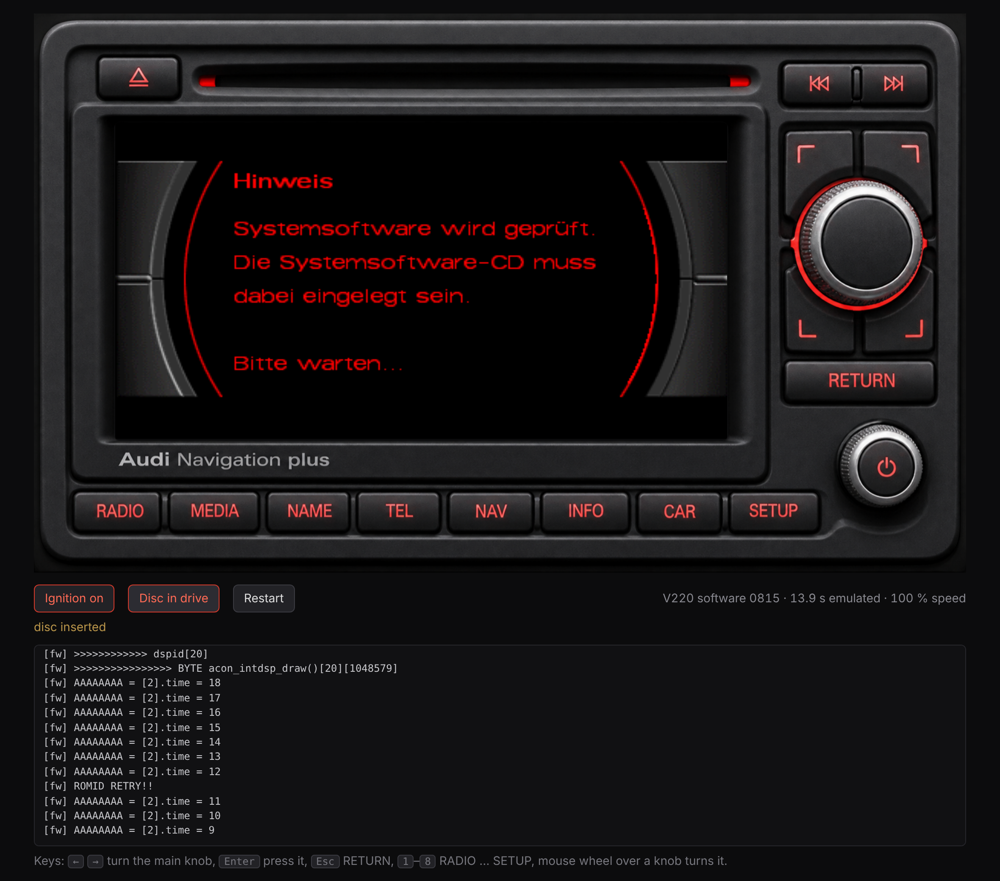
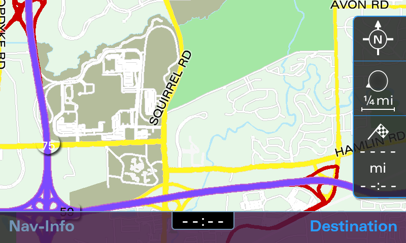

# rnse

An emulator for the Audi RNS-E navigation unit (built by Aisin AW around a
Hitachi/Renesas SH-4), written from scratch in Rust.

It runs the unit's real firmware, taken from an ordinary firmware update
CD.  No firmware is included in this repository; you need your own disc
image.

## Status

Work in progress.  The update discs carry software for two generations
of the unit, which are different computers, each in a European and a
North American version.  What runs today on the older one (part number
8P0 035 192, firmware variants `V220` and `V222`):

| | |
|---|---|
| Update loader (`LDM`) | Boots, shows its screens, reads the CD, erases and programs the flash and finishes the update, exactly as on the unit. |
| Main software (`OSM` + applications) | Boots into its user interface: radio, media, address book, telephone, navigation, info, car and set-up screens, menus and drop-down lists, drawn through the graphics chip's drawing engine.  The stand-ins for the car (ignition on the CAN bus), the radio processor and the faceplate are just enough for that; there is no tuner, sound, GPS or map behind the screens. |
| Front end | `rnse ui` shows the unit's faceplate in a browser with the live screen.  Keys, soft keys and both knobs work (mouse, touch or keyboard); below are the firmware's debug log and switches for ignition and the disc. |

And on the 2010 unit (8P0 035 193, variants `V574`, `V575` and `VB48`),
which is built around an SH7770-family system-on-chip:

| | |
|---|---|
| Update loader | Boots, shows its screen on the 800 x 480 display, reads the CD and writes the flash; the result is byte-for-byte the modules on the disc.  `rnse loader disc.iso --variant V574` |
| Main software | Boots into its user interface: start-up picture, then the screens (radio, set-up and the others) drawn through the chip's 2D graphics engine onto the display unit's blended planes, with the car (ignition), the radio processor, the faceplate and the drive answered as on the 192.  Function keys, soft keys and the main knob work, also in the browser front end.  A freshly installed unit asks for the navigation disc first; the keys work regardless.  With an audio CD (`--audio-cd 12x200`: twelve tracks of 200 s) MEDIA lists the tracks and plays them, silently so far.  `rnse ui disc.iso --variant V574` |

The North American 192 software (`V222`) runs like `V220`, in English:
`rnse ui disc.iso --variant V222`.

With a navigation DVD in the 193's drive (`--nav-disc`: an ISO image, or
the image of an SD card prepared for the unit) the navigation software
reads it, shows its destination menus and draws the map, which can be
zoomed and scrolled.  `--gps LAT,LON,COURSE` gives the unit a GPS fix,
and the map shows that place; `--drive KMH` sets the car moving (speed
pulses, gyroscope, and the fix along its course), and the map follows.
`rnse ui disc.iso --variant V575 --nav-disc card.img --gps 41.8781,-87.6298,270 --drive 50@30000`
In the browser front end the 193 has a fix in San Francisco unless
`--gps` puts it elsewhere or `--no-gps` leaves it without one.

Audio CDs play on both units (`--audio-cd 12x200` for a disc of test
tones, `--audio-cd a.wav,b.wav` for recordings), and `--wav out.wav`
writes what the unit plays: the drive's output through the amplifier
as far as the radio processor's side of it is understood, silent
unless the CD is the selected source and at the volume the unit has
set with its knob. The 192's installed software reads data discs (it takes an
update disc with a higher software index for an update and runs the
whole update itself). Still missing on the 192 are the power button,
its GPS receiver and the 3D half of its graphics chip.

Both units play MP3 files from an SD card, all of it done by their own
software: `rnse card music.img folder/` makes a card image from a
folder, `--sd-card music.img` puts it in a slot, and MEDIA, the top
right key ("Quelle"/"Source") and the card's entry start the first
file.  The 193 lists folders and files, shows the time, decodes the
file itself and sends the samples out through its serial sound
interface.  The 192 has a signal processor of its own behind each card
slot (NEC µPD77115A): the emulator has that processor too, and runs the
program the unit's software downloads into it, which fetches the file
from the card and decodes it (`docs/hardware.md`, "SD card
processors").  `--wav` records what comes out:

    rnse card music.img ~/Music/some-album
    rnse boot disc.iso --variant V574 --ignition --no-disc --sd-card music.img \
        --cycles 16000000000 --key MEDIA@15000 --key SOFT_TR@17000 \
        --knob 1:1@19000 --key SELECT@20000 --wav out.wav
    rnse boot disc.iso --variant V220 --ignition --no-disc --sd-card music.img \
        --cycles 7000000000 --key MEDIA@15000 --key SOFT_TR@18000 \
        --knob 1:1@20000 --key SELECT@21500 --wav out.wav

`sdk/` has the start of a kit for writing software of your own for the
unit: start-up code, a hardware layer for each generation and seven
examples: one draws, keeps time and talks on the debug serial port, one
reads the faceplate's keys and knobs, one reads a file from the CD, one
listens and talks on the CAN bus, and three are meant for a real
unit: `probe`, which only shows that it runs and hands back to the
stock software, `report`, which reads out what the emulator has had to
assume (the processor's registers, the boot ROM, and on the 192 the
card processors' straps and clock) and shows and sends it, and `drive`,
which logs what the CD drive answers while a disc goes out and in.
`rnse custom` puts such a program in the update loader's place on a
copy of a disc (it then runs from RAM and leaves the flash alone); the
unit's own software, run in the emulator, takes such a disc for an
update and starts the program, as a real unit would have to, and the
program can end by handing over to the stock loader, which the image
carries along, so that the unit is its ordinary self again.  And
`--strict` lists what a program used that the emulator has no model of.
`--gdb PORT` puts the machine under GDB's control.
`sdk/examples/dvd` is a DVD player for the 192, started from an SD card
by the SD loader: unencrypted DVD-Video discs, MPEG-2 decoded at half
width, AC-3, MPEG and LPCM sound ([docs/dvd.md](docs/dvd.md)).
Bigger programs come from an SD card through the SD loader: Linux
(`docs/linux.md`), the shareware Doom (`docs/doom.md`) and the shareware
Quake (`docs/quake.md`), which run on the kit's own drivers, built by
`doom/build.sh` and `quake/build.sh` from doomgeneric, id's GPL Quake
source and id's shareware data, all downloaded and none kept here
(Quake reads its 18 MB of data from the card as it plays), and a Mac
Plus (`docs/umac.md`): Matt Evans's umac, built by `umac/build.sh`,
running the Mac's own ROM and System from the card at 384 x 235, with
the two knobs as its mouse; and a PC
(Tiny386) that runs MS-DOS and Windows 3.11 from a disk image installed
from your own floppies, the knobs as its mouse (`docs/win311.md`).
One example, `report`, is meant for a real unit: it reads the
processor's registers and the boot ROM (which is on no disc) and gets
them out, on the screen and over the CAN bus, where `rnse report`
puts them back together.
It runs in the emulator on both units; whether a real unit starts it is
untested.  See [docs/custom-firmware.md](docs/custom-firmware.md).

See [docs/hardware.md](docs/hardware.md) and
[docs/hardware-193.md](docs/hardware-193.md) for what is known about the
two machines, [docs/firmware-format.md](docs/firmware-format.md) for the disc
and file formats, and [docs/boot-rom.md](docs/boot-rom.md) for how the
missing boot ROM is replaced.

A modern, rotary-controlled replacement firmware for the 192, including native
SD apps, is described in [docs/modern-192.md](docs/modern-192.md).

## Building

    cargo build --release

There are no dependencies outside the Rust standard library.

## Native macOS app

Build with `./macos/build.sh`, then open `out/macos/RNS-E.app`. The native
app uses the photographed faceplate with clickable keys and rotating knobs,
live sound, media mounting, screenshots, and firmware logs. See
[macOS instructions](macos/README.md) for requirements and controls.

## Using it

Make an ISO image of a firmware update CD (2048-byte sectors, e.g.
`dd if=/dev/sr0 of=disc.iso bs=2048`).  Then:

    # What is on the disc?
    rnse info disc.iso

    # Unpack the firmware modules of every hardware variant
    rnse extract disc.iso out/

    # Run the update loader against an empty unit and keep the result
    rnse loader disc.iso --cycles 6000000000 \
        --screenshot update.png --save-flash flash.img

    # Run the installed firmware with the faceplate in a browser
    rnse ui disc.iso                 # then open http://127.0.0.1:8080/

    # Or headless, for investigating
    rnse boot disc.iso --ignition --trace-bios --screenshot screen.png

The firmware's own debug log is printed on standard output.  The loader
writes it to a serial port inside the unit; the main software formats its
messages but sends them nowhere, so the emulator hooks its `printf` and
prints them as `[fw] ...` lines.  Much of the text is Japanese in EUC-JP;
pipe it through `iconv -f EUC-JP -t UTF-8 -c` to read it.

What the main software says while it starts (shortened):

    [fw] _/_/_/ [Fugue]Formatting system ... _/_/_/
    [fw] Call PWM_Init_Proc()
    [fw] ---------------------PWM_Tpm_Boot !!
    [fw] KLINE task started!
    [fw] PWM_LAST_ON [1]
    [fw] Now State[1] Change State[3]
    [fw] MRADIO4 ON1
    [fw] [FP] DISP ON
    [fw] LAST_ON = TRUE!!
    [fw] init_dsp_pos = 2

A scripted session, for example: wait for the radio screen, open the
set-up menu, move two entries down, open the drop-down list.

    rnse boot disc.iso --ignition --cycles 2800000000 \
        --key SETUP@7000 --knob 1:2@8500 --key SELECT@9500 \
        --screenshot menu.png

Useful options while investigating (see `rnse` without arguments for the
full list):

    --io-log [N]       log the first N accesses to every device register
    --log-after N      ... but only start after N CPU cycles
    --onchip-log       include the SH-4's own peripheral registers
    --ignition         put the ignition status frame on the CAN bus
    --can ID:HEX[@MS]  send any other CAN frame periodically
    --trace-can        CAN frames in both directions
    --trace-serial     the links to the radio processor and the faceplate
    --key KEY@MS       press a faceplate key at a given time (ms)
    --knob K:N@MS      turn a knob
    --shot MS:FILE     screenshot at a given time
    --peek ADDR,LEN    dump memory at the end
    --trace-calls A:B  list the subroutines called in a time window
    --trace-coral      display lists sent to the graphics chip
    --surface ...      save an off-screen drawing surface as a PNG
    --gps LAT,LON[,COURSE]  a GPS fix at that place, in degrees (193)
    --drive KMH[,TURN][@MS]  the car moves, turning TURN degrees a
                       second, from MS milliseconds on (193)
    --car-type N       code the unit for car type N, 1-7 (193)
    --nav-disc FILE    a navigation DVD in the drive instead (an ISO image,
                       or an SD card image with the DVD in a partition
                       of type 0x96); read as needed, not loaded
    --serial AUZ...    the unit's serial number (193), for map data made
                       for one unit; see docs/hardware-193.md
    --disc-in MS       empty drive at the start, the disc goes in at MS ms
    --spin-up MS       how long the drive takes over a disc that goes in
    --drive-times      seeks and reads take time (also with --strict)
    --sd-card FILE     an SD card in a slot (see `rnse card`)
    --sd-in MS         the card goes in at MS milliseconds, not at the start
    --sd-out MS        the card is taken out at MS milliseconds
    --trace-sd         SD card commands
    --trace-sound      the blocks of samples the 193's software sends out
    --cpu-ratio N      CPU clock as a multiple of the peripheral clock
    --trace-atapi      CD drive commands, with where the firmware was
    --trace-bios       calls into the boot ROM
    --trace-exc        every exception and interrupt
    --tp ADDR          print the registers whenever PC reaches ADDR
    --break ADDR       stop there

## In a browser, without installing anything

`web/` is a front end that needs no server of its own: the emulator
compiled to WebAssembly (`src/web.rs`), a worker that runs it and a page.
The visitor picks an image of their own update disc, and optionally of
a navigation disc, which the page reads in place; nothing is uploaded
and the site holds no firmware.  It is published at
[rns-e.com/emulator](https://rns-e.com/emulator/).

    web/build.sh                  # into target/web/site; needs the
                                  # wasm32-unknown-unknown target
    node web/smoke.mjs target/web/site/rnse.wasm disc.iso V575

## The wiki at rns-e.com

[rns-e.com](https://rns-e.com/) is a wiki about the unit, the emulator
and how both were worked out, with the browser emulator at
`/emulator/`.  The pages are Markdown in `wiki/pages/`, the photographs
(resized, camera and location data stripped) in `wiki/media/`;
`tools/wiki.py` (standard library only) turns them into a static site and
refuses broken links, missing images and photographs that still carry
metadata.

    wiki/build.sh                 # web/build.sh, then the pages, into target/wiki/site
    WIKI_ONLY=1 wiki/build.sh     # pages only, reusing target/web/site
    BUCKET=... DISTRIBUTION=... wiki/deploy.sh

`wiki/cloudfront-index.js` is the CloudFront Function that serves
`/page/` as `/page/index.html`.

## Tests

    cargo test --release

runs the unit tests.  With a disc image available,

    RNSE_DISC=disc.iso cargo test --release

additionally runs the whole update in the emulator and checks that the
flash contents each variant's loader produces are byte-for-byte the
modules from the disc, that the installed OS reaches its idle loop, and that it brings up
its user interface and reacts to a faceplate key.  With
`RNSE_NAV_DISC` set as well (see the head of `tests/disc.rs`), one more
test has the 193 read a navigation disc and draw the map.

The CPU core is also checked against QEMU with randomly generated
programs:

    cargo build --release
    tools/cpufuzz.py --count 1000            # integer instructions
    tools/cpufuzz.py --count 1000 --fpu      # plus floating point

(needs `qemu-user-static`).  `tools/cpudiff.py` finds the first diverging
instruction of a failing program.  A handful of instructions are excluded
there because QEMU 8.2 gets them wrong; those are covered by unit tests
written from the SH-4 manual instead (`src/sh4/tests.rs`).

## Layout

    src/sh4/        SH-4 CPU: interpreter, FPU, MMU, on-chip peripherals of
                    the SH7750R (192) and of the SH7770 family (193)
    src/dev/        devices: Coral graphics chip, ATAPI drive, flash, CAN,
                    serial channels, A/D converter, and stand-ins for
                    the radio processor and the faceplate controller
    src/ui.rs       HTTP server for the browser front end
    assets/         the page and the faceplate picture it uses
    src/board.rs    memory map and interrupt routing of the main board
    src/bootrom.rs  stand-in for the boot ROM (not on the disc)
    src/machine.rs  start-up sequences, boot ROM services, run loop
    src/fw.rs       ISO 9660, LOADING.KWI container, module headers
    src/bin/rnse.rs command line front end
    sdk/            start-up code, hardware layers and an example for
                    software of your own (docs/custom-firmware.md)
    tools/          CPU test tooling
    docs/           notes on the hardware and the firmware

## Legal

This is an independent hobby project for interoperability and
preservation.  It is not affiliated with Audi, Aisin AW or anyone else.
The firmware is copyrighted by its owners and is deliberately kept out of
the repository (`.gitignore` blocks the usual file types); use an image
of a disc you own.
