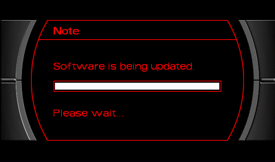

# rnse

An emulator for the Audi RNS-E navigation unit (built by Aisin AW around a
Hitachi/Renesas SH-4), written from scratch in Rust.

It runs the unit's real firmware, taken from an ordinary firmware update
CD.  No firmware is included in this repository; you need your own disc
image.

## Status

Work in progress.  What runs today, on the `V220` hardware variant:

| | |
|---|---|
| Update loader (`LDM`) | Boots, shows its screens, reads the CD, erases and programs the flash and finishes the update, exactly as on the unit. |
| Main software (`OSM` + applications) | The OS and all modules initialise, the scheduler runs with its 2 ms tick, tasks start, and the system settles in its idle loop.  The display stays off: the firmware is waiting for a wake-up condition from the car (CAN bus, front panel) that is not emulated yet. |
| Other variants on the disc (`V574`, `VB48`) | Parsed and extractable; not bootable yet (different memory map). |

Not done yet: CAN bus, front panel keys, the serial links to the radio
and GPS processors, sound, the Coral drawing engine (only display layers
are implemented), a window to watch it live.

See [docs/hardware.md](docs/hardware.md) for what is known about the
machine, [docs/firmware-format.md](docs/firmware-format.md) for the disc
and file formats, and [docs/boot-rom.md](docs/boot-rom.md) for how the
missing boot ROM is replaced.

## Building

    cargo build --release

There are no dependencies outside the Rust standard library.

## Using it

Make an ISO image of a firmware update CD (2048-byte sectors, e.g.
`dd if=/dev/sr0 of=disc.iso bs=2048`).  Then:

    # What is on the disc?
    rnse info disc.iso

    # Unpack the firmware modules of every hardware variant
    rnse extract disc.iso out/

    # Run the update loader against an empty unit and keep the result
    rnse loader disc.iso --cycles 6000000000 \
        --screenshot update.png --save-flash flash.img

    # Start the installed firmware
    rnse boot disc.iso --trace-bios --screenshot screen.png

The firmware's own debug log (it talks on a serial port inside the unit)
is printed on standard output.  Much of it is Japanese in EUC-JP; pipe it
through `iconv -f EUC-JP -t UTF-8 -c` to read it.

Useful options while investigating (see `rnse` without arguments for the
full list):

    --io-log [N]       log the first N accesses to every device register
    --log-after N      ... but only start after N CPU cycles
    --onchip-log       include the SH-4's own peripheral registers
    --trace-atapi      CD drive commands
    --trace-bios       calls into the boot ROM
    --trace-exc        every exception and interrupt
    --tp ADDR          print the registers whenever PC reaches ADDR
    --break ADDR       stop there

## Tests

    cargo test --release

runs the unit tests.  With a disc image available,

    RNSE_DISC=disc.iso cargo test --release

additionally runs the whole update in the emulator and checks that the
flash contents the loader produces are byte-for-byte the modules from the
disc, and that the installed OS reaches its idle loop.

The CPU core is also checked against QEMU with randomly generated
programs:

    cargo build --release
    tools/cpufuzz.py --count 1000            # integer instructions
    tools/cpufuzz.py --count 1000 --fpu      # plus floating point

(needs `qemu-user-static`).  `tools/cpudiff.py` finds the first diverging
instruction of a failing program.  A handful of instructions are excluded
there because QEMU 8.2 gets them wrong; those are covered by unit tests
written from the SH-4 manual instead (`src/sh4/tests.rs`).

## Layout

    src/sh4/        SH-4 CPU: interpreter, FPU, MMU, on-chip peripherals
    src/dev/        devices: Coral display controller, ATAPI drive, flash
    src/board.rs    memory map and interrupt routing of the main board
    src/bootrom.rs  stand-in for the boot ROM (not on the disc)
    src/machine.rs  start-up sequences, boot ROM services, run loop
    src/fw.rs       ISO 9660, LOADING.KWI container, module headers
    src/bin/rnse.rs command line front end
    tools/          CPU test tooling
    docs/           notes on the hardware and the firmware

## Legal

This is an independent hobby project for interoperability and
preservation.  It is not affiliated with Audi, Aisin AW or anyone else.
The firmware is copyrighted by its owners and is deliberately kept out of
the repository (`.gitignore` blocks the usual file types); use an image
of a disc you own.
