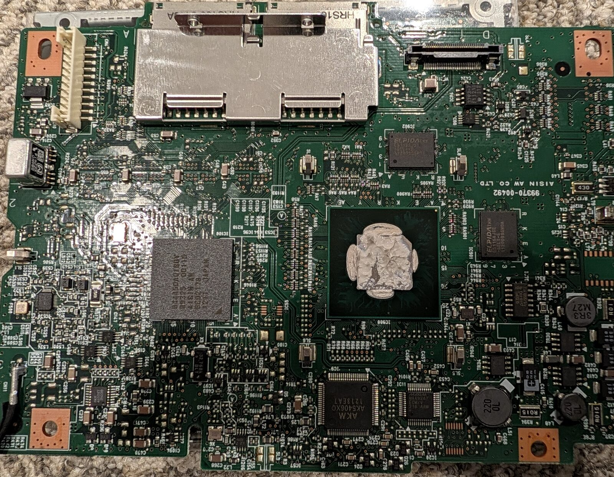
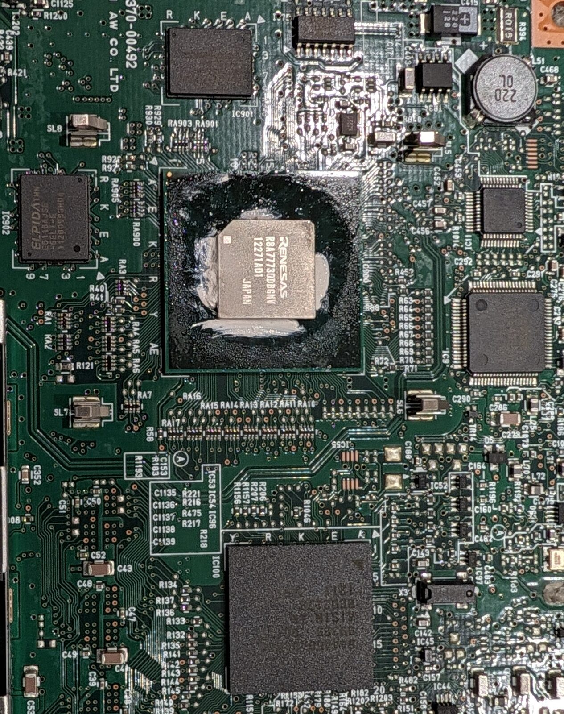
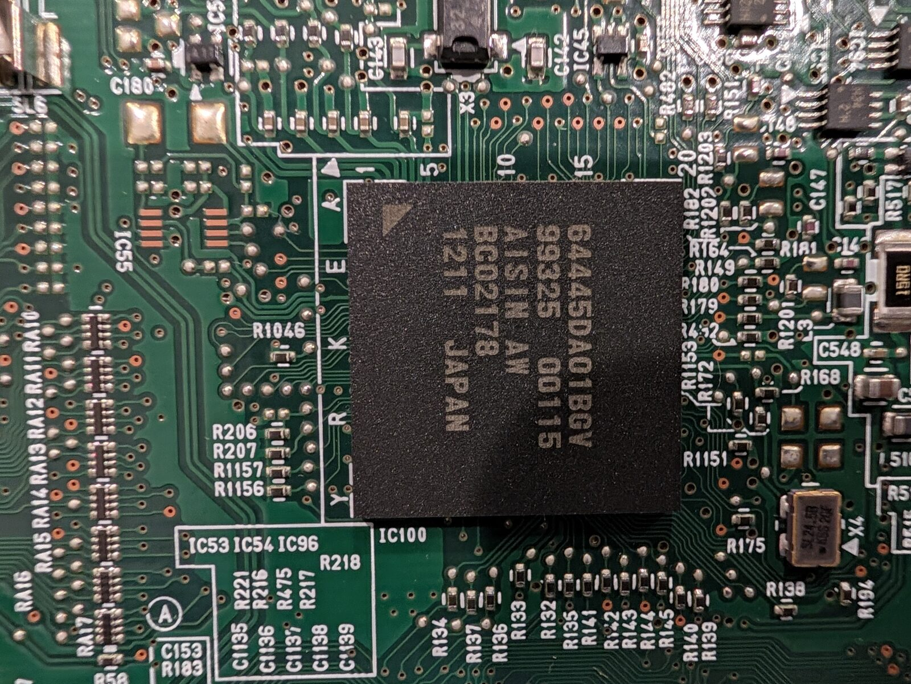
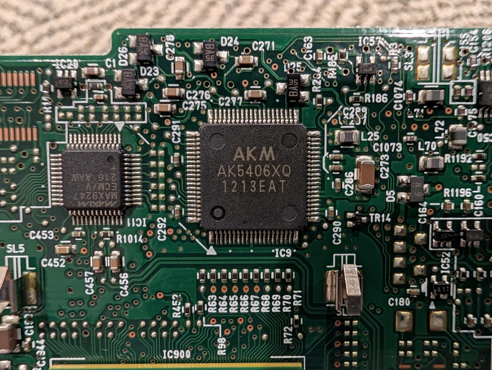
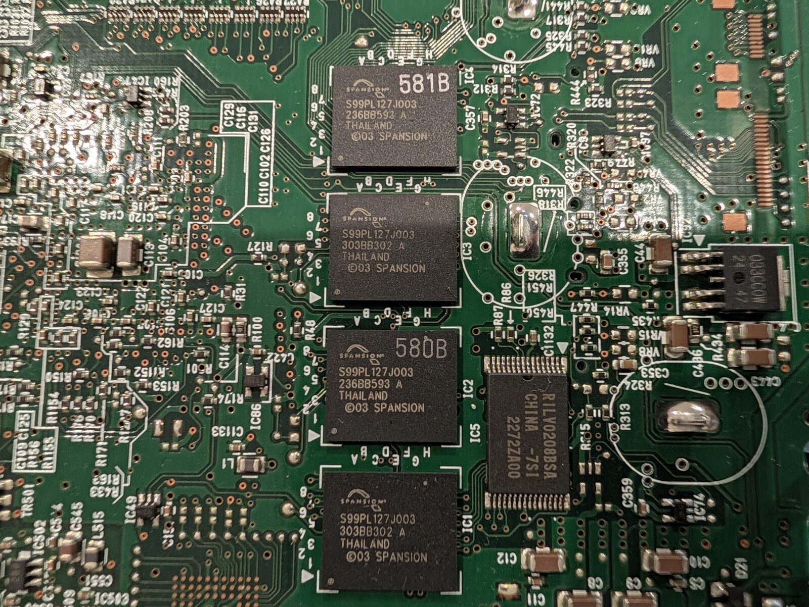
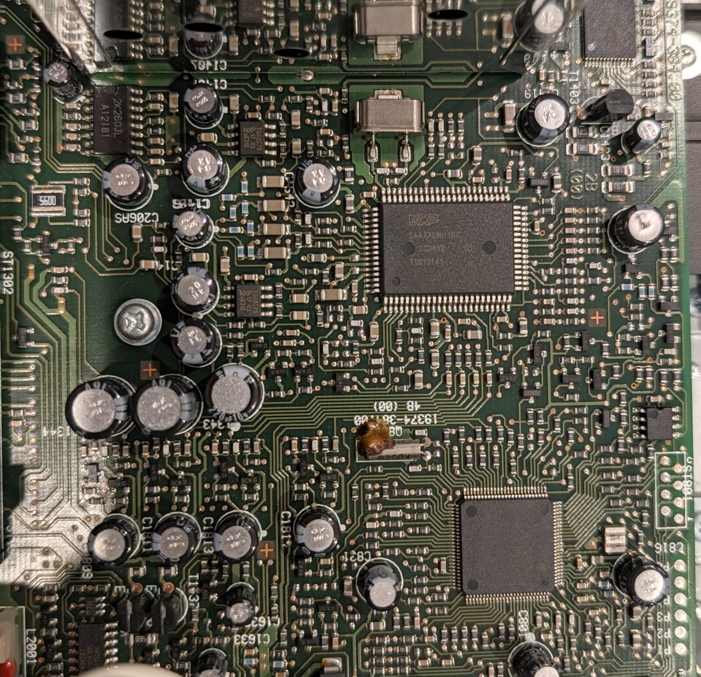
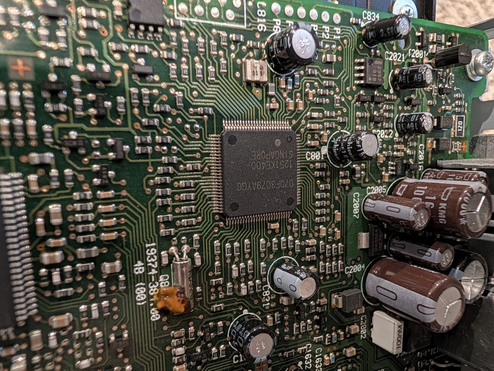
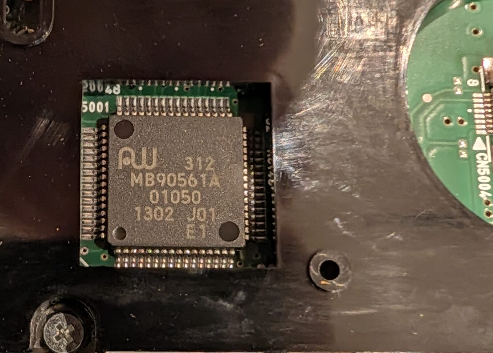
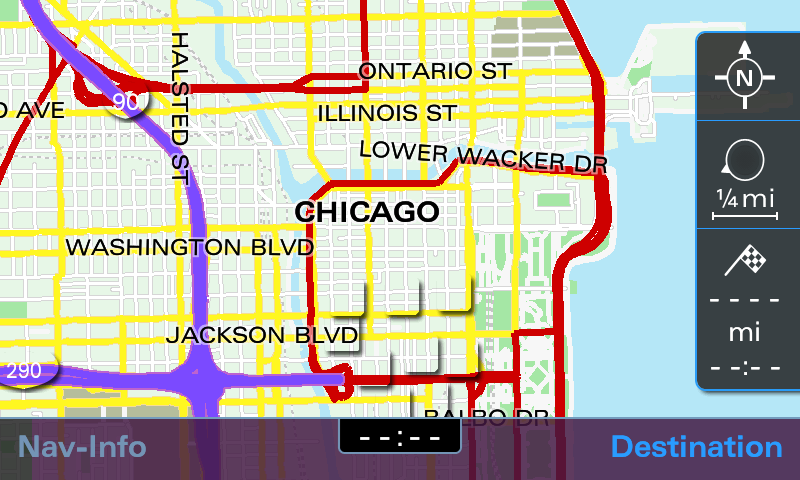
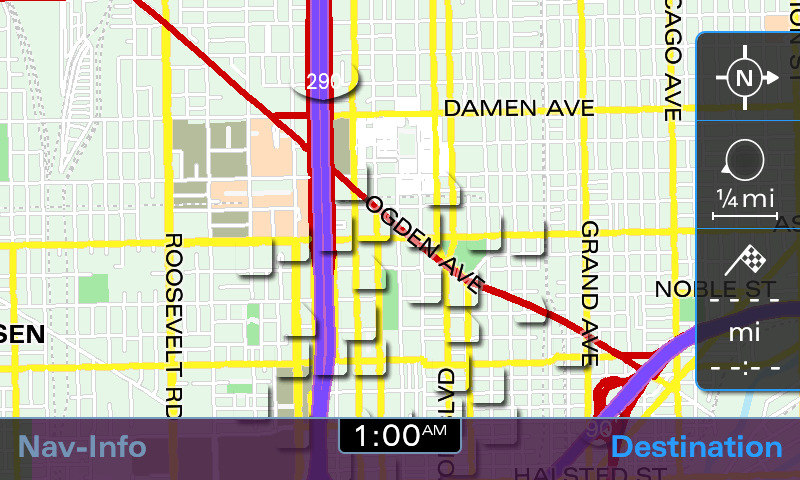

# RNS-E hardware notes: the 193 unit (variants V574, V575 and VB48)

The 2010 unit (8P0 035 193, and 8J0 035 193 in the TT) is a different
computer from the 192 described in [hardware.md](hardware.md).  Almost
everything is inside one system-on-chip, a Renesas R8A77730 by the
marking on a unit's board (see "The boards"): by Renesas' numbering
presumably an SH7773, a member of the same "SH-Navi" family as the
SH7770 these notes long took it for, and like it without a public
manual.  What follows was worked out from the firmware, with two
outside aids: the Linux kernel's SH7770 support (serial port addresses)
and the Linux driver for the display unit of the later R-Car chips,
which inherited the block almost unchanged.

Variant `V574` (software index 0220) and `VB48` (0700) use the same
memory map and the same radio processor software; their loaders differ
by a few bytes.  Which cars `VB48` is for is not known.  `V575` is the
North American software for the same hardware: index 0200 (software
1020), 0230 (1050, the one on the 2012 map DVD 8P0 919 884 BP, which
carries it) and 0320 (10AA).

## The boards

From photographs of an opened unit on a bench: an Audi TT's 8J0 035 193
F, hardware H07, software index 0230, "RNSE-PU", built in June 2013 in
Belgium (Aisin AW 86113-60A070).  The parts carry date codes from late
2012 to early 2013.

**Main board** (Aisin AW 99370-00492; the other side is marked TPD-9A
V0), the processor's side:

| part | marking | what it is |
|------|---------|------------|
| IC900 | Renesas `R8A77730DBGW`, `1227` | the system-on-chip, a ball-grid package under a heat-spreader pad |
| IC901, IC902 | Elpida `E5116AJSE-6E-E` | two DDR2 SDRAMs of 512 Mbit, 16 bits wide: the 128 MiB of RAM at 0x08000000, on a 32-bit bus |
| IC100 | `64445DA01BGV`, `99325 00115`, `AISIN AW` | a large ball-grid chip of Aisin's own, with a crystal of its own (X4) beside it: not identified.  The unexplained writes at 0xfe008000 and 0xfe800100 (memory map) are candidates for it; nothing links them yet |
| IC9 | AKM `AK5406XQ` | not identified from its marking; beside the serializer, and the AMP connector has inputs for red, green, blue and sync, so presumably the converter of that picture input |
| IC11 | Maxim `MAX9247` | a serializer for LVDS: the picture goes to the panel in the display this way |
| X1 | `D332K` | the crystal beside the SoC.  The peripheral clock measures 49.85 MHz ("Clocks and time"), one and a half times 33.23 MHz: twelve times that is 398.8 MHz for the CPU.  The crystal itself has not been measured |
| | Hirose `HRS163-3416A` | the two SD card slots, in one shielded holder, wired to the SoC: there are no card processors as on the 192 |
| CN11 | | the GPS aerial's coaxial cable; no GPS module as on the 192, so the receiver's front end is on the board and the rest in the SoC's GPS block |

The other side:

| part | marking | what it is |
|------|---------|------------|
| IC1, IC2, IC4, IC5 | Spansion `S99PL127J003` | four NOR flash chips of 128 Mbit, 16 bits wide: the 64 MiB at address 0.  Two of them (IC2, IC4) carry paper labels (`580B`, `581B`) and an older lot number, as parts programmed before assembly do |
| | Renesas `R1LV0208BSA-7SI` | static RAM of 256 K x 8 bits: the 256 KiB of battery-backed memory at 0x18000000 |

How the four flash chips are wired is settled by the stock loader (`rnse
loader ... --trace-flash`): it writes every command as a 32-bit word
with the command in both halves (0x00aa00aa to 0x1554, 0x00550055 to
0xaa8), so two chips sit side by side on the 32-bit bus, one half of
every word in each; and it erases in steps of 128 KiB, two of the
chips' 64 KiB sectors, except from 0x01fe0000 to 0x0201c000, where it
steps by 16 KiB: two of their eight 8 KiB sectors at the top of a chip
and at the bottom of the next.  So the flash is two banks of 32 MiB,
each a pair of chips with small sectors at both ends.  The emulator
models it so (`src/dev/flash.rs`).  What the chips answer to the
autoselect and query commands is taken from Spansion's data sheet
(manufacturer 1, device 0x227e, 0x2220, 0x2200) until a unit has said
it.  The unit's parameter block and serial number (0x03ff401f) are in
the second bank's small sectors at the top.

The battery-backed memory is one part of 256 KiB; the stock software
(V575 1020 and 1050) uses it up to offset 0x3aec0.  The emulator makes
it repeat above 256 KiB, as it does on the 192; whether the unit's
address decoding does the same is not known.

**Radio board** (Grundig, labelled "Aisin RNS-E Power up US", software
0022, board 19374-384.00): the two tuner modules, an NEC `D70F3079AY`
(the same V850 microcontroller as the 192's radio processor; its
software, `A5750022.MOT`, is on the update discs), an NXP `SAA7706H`
car radio signal processor where the 192 has the `SAA7709H`, and two
NXP `TDA8579` line drivers.

**Faceplate**: a Fujitsu `MB90561A` with Aisin's mark (mask `01050`),
the same part as on the 192.  **Drive**: an Alpine `DV35M110` with a
Panasonic controller, as in the 192 photographed.

Caches: the OS writes 0x80008181 to CCR (0xff00001c) like the 192's,
the update loader 0x00000101; either way both caches are on, stores
through P1 are written through and stores through P0 are copy-back.
The loader, linked at 0x09b60000, runs in P0.

## Memory map

| range                 | device |
|-----------------------|--------|
| 0x00000000-0x03ffffff | NOR flash, 64 MiB: two banks of 32 MiB, each two 16-bit Spansion PL127J side by side (see "The boards"); the same command set as the 192's, sent to both chips of a bank at once; sectors of 128 KiB, 16 KiB in the first and last 128 KiB of a bank (the loader erases 0x00400000-0x02ffffff in such steps and nothing below, where the boot ROM is) |
| 0x08000000-0x0fffffff | RAM, 128 MiB (the loader's stack starts at 0x8fffdf00) |
| 0x18000000-0x1803ffff | battery-backed SRAM, 256 KiB (one Renesas R1LV0208BSA; the OS has some 1800 references to it and uses it up to 0x3aec0) |
| 0xfe008000, 0xfe800100 | not identified (a few writes at start-up; 0xfe800100 takes the key 0xa55a) |
| 0xfe800220, 0xfe800280 | the memory controller's: the loader writes to +0x220 what it computes from bits 10-18 of +0x280 (less 2, with bit 12 set).  +0x280 reads 0x024924e5 on a bench unit (so 0x1047 is written), +0x220 reads 0 (2026-11-21); the emulator gives +0x280 that value |
| 0xff801000-0xff8014ff | DMA channels, 0x80 apart, and their common registers at 0xff801400 (see "DMA channels") |
| 0xff802000            | interrupt pin control (the layout of the SH7780's INTC: sense, mask and mask-clear registers) |
| 0xff804000            | interrupt controller |
| 0xff902000            | a second block of interrupt priority and mask registers, written alongside 0xff804000 (not emulated) |
| 0xff907000            | a clock that keeps running, used by the GPS library only: six 16-bit values to set at +0x06..+0x10 (the last one shifted left by five), taken over by writing 0xffff to +0x02; the running values at +0x12..+0x1c, read once bit 1 of +0x04 is clear.  Which value is which (date and time, by their number) is not established; not emulated, the registers read back what was written |
| 0xff908000            | ten registers written in groups at start-up, purpose not established (not emulated) |
| 0xff909000            | a port: +0 written 0, 0xc0000000 and later 0xc0100000 (direction or pin function, not understood), data at +4.  Data bit 1 is the faceplate controller's reset line, low = reset; bits 0 and 3 are set at start-up and unidentified |
| 0xff90a000            | SD host interface for the two card slots (see "SD cards") |
| 0xff915000            | serial port to the radio processor |
| 0xff926000            | serial port with FIFO to the faceplate controller |
| 0xff923000, 0xff927000 | further serial ports with FIFO (not emulated) |
| 0xff93c000            | A/D converter |
| 0xff972000            | audio clock: 0x3dff for sample rates of the 44.1 kHz family, 0x3eff for those of the 48 kHz family |
| 0xff984000            | serial sound interface (see "Sound output") |
| 0xff93e000, 0xff93f000, 0xff940000 | ports; 0xff93f000 has the display motor and the supply monitor |
| 0xffc40000, 0xffc44000 | ports; 0xffc44008 bit 0 strobes the external watchdog |
| 0xffc62100            | ATAPI interface |
| 0xffd80000, 0xffd81000, 0xffd82000 | timer units, three channels each, SH7750 layout |
| 0xffdf0000            | CAN controller (RCAN-ET) |
| 0xffe40000            | serial port with FIFO, initialised by the loader but silent |
| 0xffe80000            | 2D graphics engine |
| 0xfff80000            | display unit |

Flash layout as the loader leaves it: boot ROM from 0 (not on the disc),
the module directory at 0x400000, the OS at 0x400200, the other modules
between 0xb00000 and 0x2f50000, and data from the disc's `SDS` directory
in between.  A module is stored with its 0x80-byte header, at its load
address.

## Interrupts

On-chip sources go through a controller with the layout of the SH7780's
INTC2: twelve priority registers from 0xff804000 holding four fields
each (the firmware writes them as bytes; the level is the value divided
by two), mask-set and mask-clear registers at +0x38/+0x3c and a second
pair at +0x108/+0x10c.  Everything is masked after reset.  +0x30 and
+0x100 show the requests of the two halves, +0x34 and +0x104 those that
are not masked; the radio link's handler looks at +0x100 before it
touches its port.

| source | INTEVT | priority field | mask bit | level used |
|--------|--------|----------------|----------|------------|
| display (vertical blanking) | 0x3e0 | PRI0 bits 31:24 | 0 | 14 (loader), 8 (OS) |
| timer 0 (tick) | 0x400 | PRI0 bits 23:16 | 1 | 7 |
| timer 2, underflow and capture | 0x440, 0x460 | PRI0 bits 15:8 and 7:0 | 1 | 14, 12 (OS) |
| timer unit 1, channel 0 (CAN) | 0x480 | PRI1 bits 31:24 | 2 | 8 |
| ATAPI | 0x5e0 | PRI1 bits 7:0 | 7 | 3 |
| CAN | 0x880 | PRI5 bits 23:16 | 25 | 5 |
| graphics engine | 0x780 | PRI3 bits 7:0 | 19 | 7 |
| serial port, radio processor | 0xd20 | PRI9 bits 15:8 | 9 of the second pair | 2 |
| serial port, faceplate | 0xdc0 | PRI10 bits 23:16 | 14 of the second pair | 9 |
| A/D converter | 0xf00 | PRI11 bits 15:8 | none found | 11 |
| SD host interface | 0xea0 | PRI11 bits 31:24 | 21 of the second pair | |
| DMA channel 3 (sound) | 0x980 | PRI6 bits 31:24 | 27 | 6 |
| serial sound interface | 0xca0 | PRI9 bits 31:24 | 5 of the second pair | 6 |

The levels are the ones the 192 uses for the same jobs.  The timer
fields are an inference: the loader sets bits 23:16 when it starts timer
0 and the OS sets the two lower fields for timer 2, whose handlers sit
at 0x440 and 0x460.  When the OS enables the display interrupt it also
sets bit 0 of 0xff802000, so that one may be a pin rather than the
display unit's own request line; the emulator raises it from the display
unit's vertical-blanking flag either way.  The loader's
table of handlers also has entries for 0x220-0x3c0 (external interrupt
levels), 0x4c0, 0x660, 0x680, 0xaa0, 0xac0 and 0xe80, which it does not
use.

The CAN timer is a separate channel at `0xffd81008` (reload),
`0xffd8100c` (counter), `0xffd81010` (control), started by bit 0 of
`0xffd81004`. V57510AA's interrupt table installs wrapper `804cc58c`
at exception `480`; it calls `806305a0`, which clears this timer's
underflow and wakes the CAN task every second interrupt. The boot ROM
stand-in starts it at 5 ms, as a bench unit has it (reload 0xf3e5,
62437 counts, read under the kit's monitor 2026-11-21; see
[boot-rom.md](boot-rom.md)).

## Display unit

800 x 480 panel.  Register names below are those of the Linux R-Car
driver.

* Timing: a display period of 832 x 496 inside 1056 x 525, data enable
  800 wide.  The loader starts the period at column 181 and line 24 and
  draws its picture 16 columns and 8 lines into its surface; the OS
  starts it at 197/32 and draws from the surface's corner.  So the panel
  begins at a fixed place in the frame, 18 columns before the start of
  data enable (215) and at line 32, and that is what the emulator shows.
* Eight planes at +0x100 * n: mode at +0x00 (bits 1:0 = 8 bpp with
  palette, RGB 565 or ARGB 1555; bits 9:8 = which of four palettes;
  bits 14:12 = how the plane is laid over those behind it: bit 14 = no
  transparent colour, 1 in the low two = alpha blending), memory width
  +0x04, alpha +0x08, size +0x10/+0x14, position +0x18/+0x1c, surface
  address +0x20 (repeated at +0x24 and +0x28), start position in the
  surface +0x30/+0x34, transparent colour +0x44 (8 bpp) and +0x48 (16
  bpp), memory length +0x50.  Surfaces are ordinary RAM.
* Alpha: bits 10:8 of the alpha register say where the blending ratio
  comes from.  0: the low byte.  3: per pixel from another plane, whose
  number (from 0) is in the low bits: an 8 bpp plane that is enabled
  like the others but is not a picture.  The OS's frame and note
  overlays work this way, each with its alpha plane's surface directly
  behind its own in memory.  7 (with 0 or 1 in the low bits) is used
  for the main picture and its pop-up lists while menus are shown; what
  it selects is not known, and the emulator shows such planes without
  blending.  The A bit of ARGB 1555 pixels is not interpreted.
* Plane priority register (+0x18): eight nibbles, each naming a plane
  and enabling it with bit 3; the lowest nibble is the front.  (The OS
  puts its blended overlays in the low nibbles and the alpha planes in
  the highest.)
* Four palettes of 256 entries at +0x1000 * n, 0x00RRGGBB.  On the
  bench 193 an entry keeps six bits of each colour (0x00ffffff reads
  back as 0x00fcfcfc), and entries nothing has written hold random
  values with those low bits clear; the emulator stores them so.
* +0x20 and +0x24 take a key in their top half (the OS writes
  0x77730001 and 0x77730011): the bench 193 kept only the low half.
* Status at +0x08 (bit 11 = vertical blanking, bit 14 = frame), cleared
  through +0x0c, enabled as interrupts through +0x10.

The loader draws 8 bpp into a surface at 0x08110000 (the same frame
buffer offset as on the 192) shown on plane 6 with palette 2.  The OS
uses plane 6 (16 bpp, transparent colour 0x7c1f) for its main picture
and planes 1 and 3 as blended overlays (the note in the picture above
is one), with planes 8 and 7 as their alpha.

### On the bench 193

(2026-11-21, rnse-sdk `examples/sdload193` and `du193`; the registers
read by a program started from the disc before it touched anything.)
The stock software (V5751050, locked by its anti-theft code, at its
PIN screen) leaves the display unit so:

| Register | Value |
|---|---|
| DSYSR +0x00 | 0x00100100 (the OS writes 0x00110100, bit 16 set after the start) |
| DSMR +0x04 | 0x0700f000 |
| DPPR +0x18 | 0xfed43a98: planes 1, 2, 3, 6, 7, 8 shown |
| HDSR, HDER, VDSR, VDER | 0xc5, 0x405, 0x20, 0x210 (the loader: 0xb5, 0x3f5, 0x18, 0x208) |
| +0x94 | 0x00f800f0 |
| plane 6 | mode 0x04000002 (ARGB 1555), 800 x 496, memory width 832, surface 0x08000040 |
| planes 1-3 | mode 0x04001002, 16 bpp, surfaces 0x0a273580, 0x0a016940, 0x0a791a00 |
| planes 7, 8 | mode 0x04004000, 8 bpp, surfaces 0x0a85b200, 0x0a33cd80 |
| palettes | never written: random values |

Pixels written into those 16 bpp planes as RGB 555 showed exactly
(0x07e0 green, 0x001f blue).  **An 8 bpp plane through a palette did
not:** the kit's plane 6, set up as the loader sets up its own (mode
0x00024100, palette 2 written in full, 0x08110000), came out a flat
light grey, its white text faintly readable.  DSMR 0x0700f000, DSYSR
bit 16, +0x94 and +0x24 as the OS has them and the OS's timing, tried
one after the other, changed nothing.  Why is not known: perhaps the
palettes need enabling (+0x14 written as 0x000f0000 read back as 0).
The kit therefore draws the 193's screen at 16 bpp (RGB 555, plane 6
in mode 0x04000002) with a palette of its own in RAM.  The emulator
still draws 8 bpp planes as described above, and says once a run that
one is shown.

**The panel stays dark until POWER is pressed** on the bench 193, also
when a program of our own runs after the stock software and has set
the display unit up: whatever switches the panel on (the radio
processor or the faceplate) is outside the system-on-chip, and the
emulator does not model it.  The backlight is lit by the faceplate's
lighting command (0x06).

## Graphics engine

Everything the OS shows is drawn by a 2D engine at 0xffe80000 that runs
display lists from RAM; the firmware's messages call it "Q2", and the
register layout is that of the engine Renesas later named M2DG.  The
commands are not those of the 192's Coral chip.  [src/dev/q2.rs](../src/dev/q2.rs)
describes registers and commands as far as they are known: register
writes, rectangle fills, copies with a transparent colour, stretched
copies, and blending a colour through an 8-bit coverage map, which is
how text is drawn (the OS rasterises antialiased glyphs itself).  Surfaces are 16 bits per
pixel, or 8 for alpha.

The map is not a picture from the disc but drawn from its vectors with
further commands: polylines of a given width (roads; one variant takes
two colours and a bit pattern, for railways), and filled areas.  An
area is done in two steps, as on Hitachi's Q2 chips of the 1990s from
which the engine evidently descends: the polygon is rasterised into a
one-bit work buffer, then a quadrangle over its bounding box paints the
colour where the work buffer is set.  The round ends and joints of roads
are small octagons drawn the same way.  The navigation application
draws the map into a surface of 928 x 608 pixels and copies the middle
800 x 480 to the screen's plane, so that the map can be moved a little
without drawing it again.

Pictures that are laid over others (the panel at the right of the map,
the mark left of a list) come with an alpha map, named by the registers
at +0x64/+0x68.  The software first has command 0xab combine that map
with the alpha values of the plane drawn to and then copies with mode
bit 0x400, which blends; text goes the same way with its coverage map
as the alpha map.  The 0xab commands of several pieces can be in one
list and the drawing in the next.

The OS starts a list, waits for the interrupt its end raises (status bit
2, INTEVT 0x780) for up to two seconds and logs `Q2 TIME OUT` if it
does not come.

Two commands (0xab, 0xaa) bracket drawing into a surface that has alpha
values; what the engine does with them is partly a guess, see the source.

## ATAPI interface

Task file registers at 0xffc62100 + 4n (n = 0..7), alternate status and
device control at +0x38, one register per 32-bit word.  Data words carry
the first byte of each pair in the low half.  Interface control,
status, interrupt enable and timing registers follow from +0x80 (the
layout of the later R-Car ATAPI block); the loader sets them up once and
then works by programmed I/O.

The OS works by interrupt.  The status register (+0x84) has the drive's
interrupt line in bit 4, the end of a DMA transfer in bit 1 and an error
in bit 2; +0x88 enables each as an interrupt, and the handler switches
them off again until the driver is ready for the next.  The driver
expects the drive to interrupt when it is ready for the twelve bytes of
a packet command, which newer ATAPI drives do not do.  Disc reads go by
DMA: bit 2 of the control register (+0x80), the memory address in +0x9c
and the byte count in +0xa0 are set before the command; once the status
shows DRQ and the signal register (+0xb0) bit 0 shows the drive's DMA
request, control bit 0 starts the transfer.  Bytes land in memory in
the order the drive delivers them.

Read by programmed I/O from a program on a bench unit (rnse-sdk's
`cd_read` under `mon193`, a CD-R, 2026-11-21): sectors 0x10, 0x11-0x14,
0x100, 0x2000 and 0x5000 came back as the disc's image has them.  Four
sectors in a row took 14.7 ms (3.7 ms a sector, some 560 KiB/s); a
read somewhere else on the disc 170 to 290 ms, and the first read after
the drive had been idle longer than the 1.5 s the watchdog allows a
program that serves it from its main loop.

What kind of disc is in the drive the OS finds out with READ
SUB-CHANNEL: a CD answers, a DVD refuses with "illegal mode for this
track" (sense 5/64), and that refusal is the OS's test for a DVD (its
log then says `media judge = 1`; 2 is an audio CD, 3 a data CD).  For a
DVD it goes on to READ DVD STRUCTURE and wants a DVD-ROM with one
read-only layer.  The emulated drive reports any data disc larger than
a CD as such a DVD.

Audio CDs are played by the drive itself.  For the MEDIA source the OS
reads the full table of contents (READ TOC format 2), starts the player
with PLAY CD (0xbc, addresses in minutes, seconds and frames, from the
first track to the lead-out) and then polls READ SUB-CHANNEL for the
position it shows.  The emulated drive keeps time for that to the
sample, and what it plays can be had as sound (`--wav`), through the
amplifier as the radio processor's stand-in models it (source and
volume, see the 192's notes on the radio processor).

## CAN

Telephone-module investigation and the remaining protocol prerequisites
are recorded in [telephone.md](telephone.md).

RCAN-ET at 0xffdf0000: the control registers of the 192's HCAN2, but a
mailbox has the identifier at `STDID << 2`, the acceptance mask at +4
and the control word (type, length) at +0x10.  The loader sends the same
messages as the 192's: 0x661 and 0x604 status frames and network
management on 0x436.

Bit timing as the loader sets it, after putting the controller in reset
(MCR = 1): BCR0 (+0x06) = 0x000b, BCR1 (+0x04) = 0xb730, a prescaler of
12 and 1 + 12 + 8 = 21 quanta a bit.  With the HCAN2's rule (a quantum
is two clock periods times the prescaler) that is 100 kbit/s from 50.4
MHz, the peripheral clock (see "Clocks and time").

The control register (+0) reads 0x8000 under the stock software, and
its top bit decides where a mailbox's first word has the identifier:
two bits up with it set, four bits up with it cleared.  A bench unit
whose controller the kit set up from reset with 1 and then 0 in that
register sent what was written for 0x7f8 as 0x1fe and took none of the
frames sent to it for what they were; set up the same way with 0x8001
and 0x8000 it talked and listened as under the stock set-up (rnse-sdk's
`mon193`, `can_try`, 2026-11-21).  That was the "silent bus" of the
kit's `can_init` on a unit.  The emulator's controller does the same.

### Who sets up the mailboxes

The OS programs its transmit mailboxes but no receive mailbox: it only
unmasks mailbox interrupts and then looks at the identifier of whatever
arrives, so the boot ROM must have set the receive side up.  The one
fixed point in the OS's receive path is mailbox 24, treated (as in the
loader) as the network management range 0x400-0x43f.

The receive mailboxes as a bench unit has them (V575 0310, read through
rnse-sdk's `mon193` after its SD loader had taken the unit over,
2026-11-21; control word 0x0300 at +0x10, the mask at +4 with a set bit
meaning "any"):

| mailbox | identifiers | |
|---------|-------------|-|
| 0 | any | what no other mailbox takes |
| 18, 19, 20 | 0x600-0x6ff, 0x600-0x67f, 0x600-0x63f | three of falling width, so that a burst in the lower ranges has more than one place |
| 21 | 0x500-0x5ff | |
| 22 | 0x300-0x3ff | |
| 23 | 0x200-0x2ff | the ignition lock's 0x271 among them |
| 24 | | the kit's by then (every identifier); see above |
| 25 | 0x4d0-0x4df | |
| 26-31 | 0x63c, 0x6da, 0x6dc, 0x6c1, 0x6c5, 0x6d1 | one each |

The base of a range is taken from the mask and the last identifier
received; mailboxes 2-17 are the OS's for sending (two copies of the
cluster's lines on 0x363 and 0x365, 0x661 and 0x604 among them;
mailbox 1 was the kit's).  The controller looks for a mailbox from 31 down: a
frame for the kit's mailbox 24 never reaches mailbox 0.  The emulator's
boot ROM stand-in programs this table (it had a single mailbox for
every identifier at 31 before, which kept every frame from a program's
mailbox 24 once nobody read it).

The OS's table of expected messages (36 slots of 40 bytes at 0x8eac58a8
in V5741040) lists 0x200, 0x271, 0x2c3, 0x351, 0x353, 0x359, 0x497,
0x523, 0x527, 0x543, 0x5c3, 0x602, 0x621, 0x623, 0x625, 0x627, 0x635,
0x63c, 0x651, 0x65d, 0x65f, 0x662, 0x665, 0x6c1, 0x6c5, 0x6d0, 0x6d1,
0x6da and 0x6dc; it transmits 0x252, 0x25b, 0x261, 0x263, 0x361, 0x461,
0x5ab, 0x604, 0x661, 0x67a, 0x6c0, 0x6c4, 0x6c6 and 0x6ca.  With the
ignition message (0x271) arriving, the power manager goes on as on the
192.

The OS does not start from nothing here either: early on it asks the
boot ROM (service 0x0b) for the state of the boot ROM's own CAN software,
including the table of received messages and whether the ignition lock's
message (0x271, or 0x2c3 on another generation of car) has been seen,
and decides from the first byte of that message (bit 0 = key in the
lock, bit 1 = ignition) whether to start up or go back to sleep.
See [boot-rom.md](boot-rom.md).

## Serial links

* 0xff915000, to the radio processor: the 192's companion-chip serial
  port with its registers four bytes apart (mode +0, baud rate +4,
  control +8, transmit +0xc, status +0x10, receive +0x14, FIFO control
  +0x18).  The protocol is the 192's (`01 command length data
  checksum`), and the OS asks the same things in the same order.
  The OS sends it 8a every 30 s and 81 [06] every 60 s, for as long as
  it runs.  Without them the radio processor starts the unit again, and
  what it wants is the first (a bench unit under rnse-sdk's `mon193`,
  2026-11-21): sent nothing, the unit started again after 806 s; sent
  81 [06] once a minute (each acknowledged, 20 [00]), it started again
  900 s after the first, at the moment the sixteenth went out; sent
  both as the OS sends them (8a answered with an empty 8a), it was
  still up after 25 minutes.  The front stayed lit through all three.
  The emulator restarts a 193 that sends no 8a for 815 s
  (`--radio-keepalive`).  While a program runs that asks it nothing,
  the radio processor sends its status block (0x88, 58 bytes) by itself
  about once a second (again and again, by the look of it, because
  nobody acknowledges it).
  The tuner and the amplifier take the 192's frames on a unit (rnse-sdk
  `tools/bench193/tuner.script`, 2026-11-21): `82 [03 02 hi lo]` tunes
  (acknowledged with 20 [00]; the radio processor then sends two frames
  0x87 of its own, `20 10 09 06 hi lo` and 0.3 s later `20 10 09 04 hi
  lo`), `19 [01 v]` sets the volume, and the status block has the
  frequency at 4 and 5 (in steps of 50 kHz: 06 f2 for 88.9 MHz), the
  source at 33 and the volume at 34, as the 192's.  Its byte 3 was 0x14
  as the stock software left the tuner and 0x04 after a frequency set
  this way; what the bit says is not known.  The emulator's stand-in
  does not send the 0x87 frames.
* 0xff926000, to the faceplate controller: an ordinary SCIF (control
  +0x08, transmit +0x0c, status +0x10, receive +0x14, FIFO control
  +0x18, receive count +0x20).  Same frames as on the 192; the OS sends
  commands 0x02, 0x03, 0x06, 0x07, 0x09 and 0x0a once the controller has
  announced itself with 0x0f.
  Set-up by the OS: control 0, FIFO control 6 (both FIFOs held empty),
  status flags cleared, mode 0x0020 (8 bits, even parity), bit rate
  0xa1; then the controller's reset line (bit 1 of 0xff909004) goes
  high, FIFO control 0, control 0x30.  0xa1 is 9600 bit/s from the
  50 MHz peripheral clock; the debug port's divisor (0x36 at +0x30,
  sixteen samples a bit) gives 57600.  As on the 192 the OS resets the
  controller when it leaves a command unanswered for a second.

## A/D converter and ports

The converter at 0xff93c000 has eight results at +0x00..+0x0e and a
control register at +0x10 (bit 15 = done, bit 14 = interrupt enable,
bit 13 = start).  The OS converts all inputs every few milliseconds and
averages them:

* input 4: position of the motorised display, as on the 192 (low =
  open; the OS logs `init_dsp_pos = 2` when it reads as closed);
* input 5: a temperature (the OS computes 25 + (1.45 V - U) / 8.2 mV);
* another input tells the type of screen fitted; the emulator leaves it
  at zero, which the OS logs as an error (`Adc_get_scrntype return
  ZERO`) and survives.

Port 0xff93f000 (direction +4, output +8, input +0xc): output bits 19
and 18 drive the display motor (assumed: 19 towards closed), input bit
20 is low only when the display is fully open, and input bit 22 has to
be high or the OS stops itself after four and a half seconds, waiting for the
watchdog: presumably the supply voltage monitor.

The SDK's display driver (`sdk/src/hw193.c`) runs the motor on that
assumption, and the emulator's model agrees with it by construction;
it has not been tried on a 193 (the kit leaves the display key alone
there).

Port 0xff909000 (+0, +4): bit 1 of +4 is the faceplate controller's
reset line (low = reset), which the stock software lowers and raises;
nothing else of the port is its.  The bench 193 read 0xdfffffff and
0xfffffffb there after the stock software had run, and the emulator
starts the port so (the reset line low): a program that writes the
whole register drives the drive's and others' lines low, which on the
unit set the drive ejecting and loading over and over.  The faceplate's
keys are those of the 192 (message 0x0c: CD EJECT bit 31, the display
key bit 13).

## Watchdog

External, strobed through bit 0 of the port at 0xffc44008 from the
tick, every 10 ms; the longest pause the OS leaves while it starts is
about 135 ms.  The loader ends an update by printing `*** WDT Reset ***`
and no longer strobing; when it gets impatient it jumps to address 0
itself.  The emulator resets after 1.5 s without an edge (the real
limit is not known).

The loader toggles the bit with 32-bit accesses.  The OS reads the
register as 32 bits, flips bit 0 and writes the result back as a *byte*
at the same address, through a routine it uses for all its ports.  In
memory that byte would be bits 31..24 and the strobe would never move;
since the OS evidently keeps a real unit alive, the registers of the
port blocks at 0xffc40000 and 0xffc44000 must give an access of any
size their low bits, and they are emulated so.

## Debug serial port

A SCIF at 0xffe40000 with the register layout of the faceplate's
(16-bit registers four apart: mode +0, bit rate +4, control +8, transmit
data +0xc, status +0x10, receive data +0x14, FIFO control +0x18).  The
loader and the OS's low-level output write characters to it after
setting control bit 5 (transmitter enable); the emulator prints what is
sent as the console, and nothing while the transmitter is off.

## Timer interrupts

A timer goes on asking for its interrupt for a moment after its
underflow flag has been cleared.  On a bench unit the kit's tick
handler, which cleared the flag (a read and a write of the control
register) first thing and returned some dozens of instructions later,
was entered a second time for every underflow: the kit's clock ran
exactly twice as fast as the world's, with the timer itself counting
the 12.46 MHz it should (249.3 million counts in 20.00 s, on two
channels: a quarter of a peripheral clock of 49.85 MHz).  With the
control register read back after the clear the handler is entered once
(rnse-sdk's `mon193`, 2026-11-21).  The emulator keeps the request for
400 CPU cycles after the clear unless the register is read
(`TMU_LINGER` in `src/sh4/onchip.rs`), which makes a handler like the
old one count double there as well; how long the real request lasts is
not known.

## Loader

Entry and arguments as on the 192, but the loader sets its own stack
and vector base (inside its own image).  It reads the project code from
the boot ROM header at flash 0x406, like the 192's.  Its log goes
through a `printf` (0x09e3937a in V5740002) that formats and discards;
`rnse loader` hooks it.

## Main software

The OS and the other modules have the same structure as on the 192
(three entry points each, a uITRON-style kernel, the same task names in
the debug log), with two differences in how they are started:

* The boot ROM, not the OS, calls every module's entry points: stage 1
  of each module in directory order, then stage 2, then stage 3, with
  the OS's third entry (which never returns) last.  The 192's first OS
  (V220) does this for the other modules itself; the same routine is
  still in the 193's OS but nothing calls it (V222, the later 192
  software, already works the new way).  The order matters: the application's
  first entry moves the memory break (boot ROM service 5) from the end
  of the OS's data down to the end of its own, at 0x0ca57004, and the
  heap the OS creates later runs from the final break up to 0x0e8cfff0,
  just below the OS's data.
* The OS replaces the boot ROM's vector tables with its own, in RAM at
  0x8e8d0000 (TRAPA handlers), 0x8e8d0400 (exception and interrupt
  handlers) and 0x8e8d0600 (interrupt mask levels), and seeds them from
  the boot ROM's: 64 handlers at the old vector base (the first 16 for
  exception codes 0x000-0x1e0, all of them for TRAPA 0-63) and 125 mask
  bytes at +0x780.  See [boot-rom.md](boot-rom.md).

As on the 192, the OS starts timer 0 for its tick without giving it
a priority; the boot ROM has done that (the loader's value is level 7,
with the timers' mask bit cleared).

### Clocks and time

The peripheral clock is 50 MHz and the OS's tick is 1 ms: timer 0
counts a quarter of the peripheral clock, as on every SH-4, and is
reloaded with 12487.  Three things that do not depend on each other say
so:

* the time the unit shows for a playing MP3 file, which it counts in
  ticks, goes up by a second for every 44100 samples it sends out (see
  "Sound output"); with a tick of 2 ms it would show half the time;
* the faceplate port's divisor makes 9600 bit/s from 50 MHz and 4800
  from 25;
* the CAN controller's bit timing makes the infotainment bus's 100
  kbit/s from 50.4 MHz.

Measured on a bench unit, the timers count 12.462 MHz (249.3 million
counts in 20.00 s on two channels of rnse-sdk's `mon193`, and a clock
kept at the stock software's 12488 counts a millisecond was 3.8 s
behind after 31 minutes; 2026-11-21): a peripheral clock of 49.85 MHz,
and the stock software's millisecond 0.2 % long.  That is one and a
half times 33.23 MHz, which the crystal X1 (`D332K`) may well be; the
CPU's 400 MHz would then be 398.8.  The emulator's peripheral clock is
49.848 MHz.

The loader's tick (62437) is 5 ms, and so is the CAN timer's period as
the boot ROM leaves it (the loaders give it 2.5 ms themselves).
(Until the sound output was modelled the emulator took the tick for
2 ms and the clock for 25 MHz, with the serial peripherals running from
twice the timers' clock; the unit then ran at half its speed measured
in its own time, which nothing showed.)

The CPU clock is taken as eight times the peripheral clock, 400 MHz,
the rated speed of this family, and the emulator
counts one instruction per cycle; this is an estimate.  The firmware's
calibrated delay routine (0x804dd960 in V5741040) runs 1056 instructions
per unit of its argument where the 192's runs 304, which fits a CPU
about three and a half times as fast.

In the emulator the OS starts all its tasks, checks its flash file
system, sees the ignition, talks to the radio processor and the
faceplate, shows its start-up picture after about fifteen seconds and
then its user interface, on all three variants.  It reads the disc in
the drive, takes keys from the faceplate and changes screens (radio,
set-up and so on).  A freshly installed unit first asks for the
navigation disc to load a language from ("Bitte Navigations-Medium
einlegen"), or says that the disc in the drive is not the right one; the
function keys work regardless.  `printf` is at
0x80688afe in V5741040, 0x80688146 in VB481000 and 0x8067b886 in
V57510AA.

## SD cards

The two card slots hang on a host interface in the system-on-chip, at
0xff90a000: registers of 16 bits in the layout known from Toshiba's
and Renesas's SD host controllers (command at +0x00, slot select +0x02,
argument +0x04, block count +0x0a, response from +0x0c, status +0x1c
and +0x1e with their masks at +0x20 and +0x22, block size +0x26, data
port +0x30, soft reset +0xe0; bit 1 of +0xd8 hands the data port to
DMA).  Its interrupt is INTEVT 0xea0.  The driver is in the OS
(`0x80688c00`-`0x80697000` in V5741040); `src/dev/sdhi.rs` is the model
and `--trace-sd` lists the commands.

What the driver does with a card, in the emulator: CMD0, CMD8, ACMD41,
CMD2, CMD3, CMD9, CMD7, for a standard-capacity card CMD16 with 512,
ACMD6 for the four-bit bus, ACMD13 and ACMD51 (their 64 and 8 bytes
read from the data port by the program), and from then on CMD17, one
sector at a time, each fetched by DMA (see "DMA channels") and each
framed by CMD13.  It reads nothing with CMD18 and writes nothing in
normal use.

It is particular about sizes: a card that answers ACMD41 as a
high-capacity card must have more than 0x3f6000 sectors (about 2 GB)
and at most 0x3fd8000 (32 GB), and a standard-capacity card at most
0x3f6000; anything else is turned away after ACMD13 and tried again
for ever.  The emulator therefore presents an image as the one kind or
the other by its size.

The OS then reads the partition table and mounts a FAT partition
(types 1, 4, 6, 0xb, 0xc, 0xe; FAT16 and FAT32 both seen working) as
`/affm/sd2` (the slot the emulator calls the first) or `/affm/sd1`.
The card is music to the stock software and nothing else: it reads the
volume label, looks for a folder `SD_AUDIO`, lists folders and files
and reads the first sector of each MP3 file.  The label then stands in
the list of sources under MEDIA ("Quelle") between the CD drive and
the other slot.  A partition of type 0x96 is not looked at, and neither
is `LOADING.KWI` anywhere on a card: updates come from the drive only
(see [boot-rom.md](boot-rom.md), "Only from the CD drive").

The modified North American software (index 0320, see "Map data made
for one unit") has code added at 0x806a9400 that is called when
`sd2` is mounted and notes the start and size of a type-0x96 partition
at 0x0e8cff3c; what it then does with them has not been followed.  With
such a card in the emulator that software records the partition and
reads no sector of it in the first half minute.

On the bench 193 (2026-11-20, rnse-sdk `examples/slot193`,
`sdcheck193`, `speed193`, with the SD bridge): select 0 is the slot the
emulator calls the first (the unit's slot 2), select 1 the other.  A
change of the select takes between 10 and 20 ms: commands 10 ms after
one still reached the slot selected before (the emulator takes 15 ms).
Bit 14 of +0x1e is set while the command line is busy, which is what
the stock driver waits on.  Multi-block reads (CMD18, block count at
+0x0a with bit 8 of +0x08 for the automatic CMD12) came at 2.9 MB/s at
the stock software's clock (divider 0 in +0x24), 1.5 MB/s at divider 1;
single blocks (CMD17) at about 1 MB/s; no bad sector.

`rnse card out.img folder [--disc disc.iso]` writes a card image from a
folder (FAT16, long names), with a disc's volume in a type-0x96
partition if wanted; `--sd-card out.img` puts it in the slot.

## DMA channels

Channels 0x80 apart from 0xff801000 and a block of common registers at
0xff801400.  Two are in use: channel 4 (0xff801200) by the SD card
driver, which polls it, and channel 3 (0xff801180) for sound.

| register | meaning |
|----------|---------|
| +0x00, +0x04, +0x08 | source address, destination address, count of transfers (16 bits each from the SD host's data port: 0x100 a sector; 32 bits each to the sound interface) |
| +0x0c, +0x10, +0x14 | a second set of the three |
| +0x28 | mode: 0x00402112 for the SD driver's reads, 0x05050022 for sound |
| +0x2c | control.  Bit 0: run.  Bit 1: the set that is not in use has been loaded, go on with it when this one is done.  Bit 2: stop when this one is done |
| +0x30 | write 1: stop |
| +0x34 | status.  Bit 0: running.  Bit 1: a loaded set is waiting.  Bit 6: the first set is the one in use |

Common block, bit 2n for channel n: +0x10 a set's count has run out,
+0x14 write 1 to clear that, +0x18 interrupt enable.  Channel 3's
interrupt is INTEVT 0x980 (channel 4's would be 0x9c0, going by the
handler number its driver removes).  0xff903024 is written 0x200 before
each transfer of the SD driver and is not understood.

The control and status bits are read off the sound driver
(`0x806495d4` in V5741040), which keeps two blocks queued: it loads the
set the status says is free, sets bit 1, and in the interrupt handler
for a finished set loads the next; when it has nothing more it sets bit
2 instead.  That the address and count registers count during a
transfer is assumed; nothing reads them back.

## Sound output

The system-on-chip decodes MP3 itself, in software, and sends the
samples out through a serial sound interface at 0xff984000 with the
registers of the SSI of other Renesas chips: control at +0 (bit 0
enable, bit 1 transmit, bits 6:4 clock divider, bits 27 and 26
interrupt enables for underflow and overflow, bit 28 DMA), status at +4
(the same bits; written as zeroes to clear), transmit data at +8.  The
driver's table of sample rates (0x804b3f7c in V5741040) gives for each
rate the control bits and the value for the audio clock register at
0xff972000:

| rates | control bits | audio clock |
|-------|--------------|-------------|
| 48000, 44100 | 0x000b0030 | 0x3eff, 0x3dff |
| 32000 | 0x000b0060 | 0x3eff |
| 24000, 22050 | 0x000b0040 | 0x3eff, 0x3dff |
| 16000 | 0x000c0040 | 0x3eff |
| 12000, 11025 | 0x000d0040 | 0x3eff, 0x3dff |

A word of 32 bits goes out for every sample period: the left channel's
16 bits in the high half, the right one's in the low half.  DMA channel
3 fetches the words from buffers in RAM, in blocks of 512 to 4096
words, two queued at a time.  When a block is done the handler of
INTEVT 0x980 queues the next; when the last is done it switches the
interface off.  The interface's own interrupt (INTEVT 0xca0) is for
underflow and overflow, which the driver counts as errors, and for the
idle state.

The amplifier's source for this is 4 (see the radio processor's notes
in [hardware.md](hardware.md)); the CD drive's own audio output is 1.

In the emulator a card with MP3 files plays: MEDIA, the top right key
for the list of sources, the card, and the first file starts; the
unit shows folders, file names and the time, and `--wav` records what
comes out (`--trace-sound` lists the blocks).  A file with 440 Hz on
the left and 880 Hz on the right comes out as exactly that, without a
gap, and the next file follows.  What is assumed: how the hardware
keeps the moment between a last block and the handler switching the
interface off from counting as an underflow (the emulator reports an
underflow only when the interface has had nothing to send for more
than a millisecond), and the amplifier's gain law.  WMA, playlists
and the second slot have not been tried.

## Navigation

The map comes from a DVD (ISO 9660): `ALLDATA.KWI` with the map in
Aisin's KIWI format, index files for destination entry under `IDX`,
`VOICEDAT.KWI`, and a copy of the unit's software for updating older
units from.  Cards are sold that carry the same thing: the DVD's volume
in a second partition of type 0x96, behind a FAT partition.  The stock
software does nothing with that partition (see "SD cards"); the cards
go with a modified version of the software, and how far that one takes
the map from the card has not been followed.  The emulator puts the
partition into the DVD drive instead (`--nav-disc card.img`).

The navigation application (module `APM`, running from flash at
0x01c00000) has its own copy of the debug `printf`, at 0x021a2b16 in
V57510AA, hooked like the OS's; most of what is known about its disc
handling comes from that log.  When a disc arrives:

1. The OS reads the volume descriptor and the directory (its `CDSFS`).
   A second reader, in module `AUM`, looks for update files and
   addresses the disc by byte offsets of 32 bits, so on a DVD whose
   directory lies beyond 4 GB it reads the wrong sectors (0x0da35e for
   0x2da35e) and finds nothing.  That is the firmware's doing, not the
   emulator's, and harmless.
2. The application (`DVC`) reads `05.CMP`, a table of the disc's files,
   and the first 15 sectors of `ALLDATA.KWI`, whose header it unpacks
   and checks: the system identifiers (`dvc_chksysmid`), the format
   version (`dvc_chkafmtver`) and the metadata (`dvc_chkmetadata`).  If
   all three pass the disc is a map disc (`DISCTYPE:CDDISC_MAP`),
   otherwise at best a program disc.
3. It compares the software index on the disc (`575INDEX.TXT`) with its
   own and would offer an update if the disc's were newer.
4. Then it reads map data as it needs it (`CDREAD:` lines).

### Map data made for one unit

Map updates are also sold for a single unit, as an SD card image that
goes with a modified version of the unit's software.  On such a card
the identifiers in the header of `ALLDATA.KWI` begin with the unit's
serial number, fourteen characters and a comma, before the format
identifier (`AFUS:2.45` on a North American disc).  The modified
software (index 0320, V57510AA) has a matching addition in
`dvc_chkafmtver`, a jump out of the routine to hand-written code at
0x023468a8: if a comma follows fourteen characters, they are compared
with the fourteen bytes at 0x03ff401f in flash, the unit's own serial
number, and the check goes on behind the comma only if they are the
same.  Otherwise it fails, and a second hook replaces the text of the
resulting note with "Navigation media not authorised for use on this
unit."  A disc without the prefix, such as an original DVD, is checked
as before.

The serial number is in a parameter block of the flash (0x03ff4000,
0x4000 bytes, which the OS reads and writes by offset) that is written
at the factory and is on no update disc.  An emulated unit therefore
has none, and refuses such a card as any other unit would.  To emulate
the unit a card was made for, give the emulator that unit's serial
number with `--serial` (`Machine::set_serial`); the emulator does not
take it from the card.  The card's licence file (`licence.key` in its
FAT partition) plays no part in this check and has not been looked
into.

### What works

With a map disc accepted, NAV shows the destination menu with the
disc's regions, the entry screens with their letter wheel come up, and
the map is drawn at every scale, with street names, the scroll mode
with its cross hairs and coordinates, and the panel at the right.
Without a GPS fix the position is wherever the unit thinks it was last,
the place the software starts with; with one (`--gps`, below) the map is
where the fix says.  There is no gyroscope and no speed signal, so the
position does not move by itself.

### GPS

The receiver is not a module with a serial port.  A block of the
system-on-chip at 0xff938000 passes messages to and from a GPS library
in the OS (`GPSLIB-R03.00.07`, the code from 0x80400c00 to about
0x80436000, with tasks of its own for events, subframes, position and
so on), which works the position out itself.  The block has control and
status bits in six registers from 0xff938000, a buffer the library
writes a message to at 0xff938400 (a long word, a length, a checksum,
data from +8; bit 16 of the first register sends it) and one it reads
from at 0xff938800 (bit 16 of the register at +0x0c says there is one).
The 192 has the same thing on chip select 5 (see hardware.md).  None of
that is emulated: the library finds no satellites and reports no fix.

What it reports goes this way.  The library keeps its results in nine
blocks that `0x80423630(number, buffer)` hands out.  An interface task
of the OS (`GPSIF_TSK`) fetches them when the library signals new ones,
once a second, and makes records for the navigation application, which
asks for them through trap 33 (the sensor service: r4 = group << 8 |
function, r5 = argument): 0x10a for a record of 47 bytes with the
position, 0x10b for 48 bytes about the satellites, 0x10c for 7 bytes,
0x10e for date and time.

`--gps LAT,LON` gives the unit a fix without any of the radio side:
when the application asks for the position record and the OS has one
for it, the emulator first writes the fix over the library's "no fix"
(`src/dev/gps.rs`, which also lists what is known of the record:
status, latitude and longitude in 1/256 of an arc second, date and time
in BCD and Japanese time).  The map then shows that place and the clock
runs.  The routine and the pointer it reads the record through are
found by their code (`Machine::find_gps_getter`), in the three builds
of the V575 software seen so far.

### Speed and gyroscope

Between fixes the navigation reckons the position from distance and
turning, which the OS samples in the A/D converter's interrupt (the
routine at 0x805462f8) into a ring of 512 long words that the
application empties through service 0x304 of trap 33.  A sample has the
gyroscope in bits 31:20, flags in bits 15:14 and the number of speed
pulses since the last sample (15 at most) in bits 19:16.

* The gyroscope is input 1 of the A/D converter: the sample is
  (930 - reading) * 4, of the ten-bit reading.  The software finds the
  voltage at rest and the scale for itself.
* The speed signal is on the TCLK pin: timer 2 runs with input capture
  (TCR2 bits 7:6; the count goes to TCPR2 at 0xffd8002c and bit 9 of
  TCR2 is set), and the capture interrupt (INTEVT 0x460) counts a pulse
  and measures the time since the last.  The software starts out with
  0.4 m to the pulse.
* The pulses only count in a unit coded for one kind of car, see
  "Coding" below.

`--drive KMH[,TURN][@MS]` moves the car: pulses on TCLK at 2.5 to the
metre, the gyroscope's reading away from 418 by 5.12 for a degree per
second (a gyroscope of 25 mV per degree and second; which way round is
a guess), and the GPS fix along its course (`--gps LAT,LON,COURSE`)
with speed and course in the record.  It codes the unit for car type 5
unless `--car-type` says otherwise.  With that the map follows the
car, turned to the direction of travel, and stays on the fix.

### Coding

What a workshop codes into the unit is kept in battery-backed memory,
in a block of 64 bytes at 0xb8002c4c: the mark 0x12345678, a version
(0x02220001), the sum of the sixteen bytes that follow, then six, four
and six bytes of coding, 32 further bytes, and the mark inverted at
+0x3c.  The OS uses the block if mark and sum are right.  Otherwise it
looks for a copy in a record of 224 bytes with the same mark and a sum
of its own (checked at 0x80666bda), which it reads out of the flash
parameter block, and failing that clears the block: an uncoded unit.

The first of the last six bytes is the car type, 1 to 7 (the routine at
0x806677e8 hands the six out).  The software sorts the types into four
classes (1; 2, 6, 7; 3, 4; 5).  Only for type 5 does the capture
interrupt count speed pulses; for every other the OS notes at start-up
that the handler is to ignore them.  Where those cars' distance comes
from has not been followed up: the CAN bus carries 0x351 and 0x359,
whose handlers are at 0x8066f6dc and 0x8066f7a8.  With a type coded the
instrument cluster's task logs `car_model = 4` instead of `ffffffff`.

`--car-type N` codes an emulated unit (`Machine::set_car_type`) by
writing that block before the start.

## Battery-backed SRAM

The 256 KiB static RAM at physical `0x18000000` (P2 `0xb8000000`; one
Renesas R1LV0208BSA) holds the unit's persistent state between power
cycles.  The OS has some 1800 references to it and uses it up to about
`0x3aec0`; most of that is settings (radio stations, display and sound
preferences) that have not been broken down.  The fields identified so
far, by offset from the base:

| Offset | Content | From |
|---|---|---|
| `0x0000` | A header.  The boot ROM clears `0x00..0x18` (and `0x1a..0x1c`) on every reset, so only the rest survives a restart; a real dump reads `00 ff 00 00` then zeroes, with `0x00040000` at `0x1c`. | `src/machine.rs` (the `0x18`/`0x1a` clear), a unit dump |
| `0x1400`, `0x1402` | Counter/status half-words. | PIN handoff |
| `0x1408..0x1507` | A block the CPU does not read before the user interface is up. | PIN handoff |
| `0x2c14..0x2c4c` | The **anti-theft (THF)** block — see "Anti-theft" below. | this work, PIN handoff |
| `0x2c4c..0x2c8c` | The **coding** block — see "Coding". | `Machine::set_car_type`, this work |
| up to `~0x3aec0` | OS settings (not individually mapped). | — |

The **serial number and the factory parameter block are not here** —
they are in the flash at `0x03ff401f`/`0x03ff403a` (see "Main
software").  A common confusion, because the anti-theft reads both the
flash parameter block and this SRAM.

Both known structured blocks carry the same frame: a mark `0x12345678`
at the start and that mark inverted, `0xedcba987`, at the end, with the
OS clearing the block if the pair does not check out.

**THF block, `0x2c14` (40 bytes)** — mirrored at boot from block #6 of
the `0x033e0000` / `0x03400000` flash store (see "Anti-theft" below):

| +off | Address | Content |
|---|---|---|
| `0x00` | `0x2c14` | mark `0x12345678` |
| `0x04` | `0x2c18` | 16-bit lockout flag (`1` during 1-hour lockout; checked at `0x8061367c`) |
| `0x06` | `0x2c1a` | `wrongpin_cnt` (`0` = 2 attempts remaining, `1` = 1 remaining, `2` = lockout) |
| `0x07` | `0x2c1b` | the car's VIN, 16 ASCII bytes (`DUMMY38P00000815` on an uncoded bench unit) |
| `0x18` | `0x2c2c` | factory grace counter (`50` on blank flash; decremented per boot until `0`) |
| `0x1a` | `0x2c2e` | 16-bit Kombi (instrument cluster) auth word |
| `0x1c` | `0x2c30` | 16-bit Kombi paired flag |
| `0x1e` | `0x2c32` | persisted THF state (`1` = lockout, `2` = PIN required, `3` = authorized) |
| `0x20` | `0x2c34` | Kombi CAN `0x361` challenge PRNG accumulator (`0x8061400e`) |
| `0x24` | `0x2c38` | inverted mark `0xedcba987` |

**Coding block, `0x2c4c` (64 bytes)** — what a workshop codes (see
"Coding"): mark `0x12345678` at `+0`, a version at `+4`, a checksum of
`+0x0c..+0x1c` at `+8`, the car type (1-7) at `+0x16`, and the inverted
mark `0xedcba987` at `+0x3c`.

The emulator seeds this RAM with zeros (then the boot ROM stand-in's
clear); `--nvram FILE` starts it from a unit's dump instead, and a
dump is kept out of the repository (firmware).

## Interfaces the stock software leaves unused

Asked 2026-11-22: is there a USB, PCI, Wi-Fi or Bluetooth interface on
the 193 that custom software could turn on?  What the stock software
says (V575 10AA and 1050, the boot ROM dumped from a unit), short of
reading the chip itself:

* **Wi-Fi, Bluetooth, PCI: no.**  No radio part is on the boards, no
  chip of this family has PCI, and no module refers to registers of
  either.  The "Bluetooth" texts in the application are the screens for
  the car's telephone module, which is on the CAN bus
  ([telephone.md](telephone.md)).
* **USB: no driver in the stock software; the block itself is unproven.**
  The texts "USB storage device" are names of sources of the Audi Music
  Interface, again on CAN.  The documented relatives of the R8A77730
  have a USB 2.0 host (Renesas's announcements of the SH7770, SH7775
  and SH77721), and Linux's table for the SH7770, whose serial ports
  (0xff923000 up, a page each) and timers are where the 193's are, gives
  its USB interrupt as INTEVT 0x840.  The 193's OS installs no handler
  there (its table at 0x8e8d0400 is empty at 0x840), and of the blocks
  that the OS, the loader and the boot ROM load addresses of, none has
  the many registers of a USB host controller except those named
  below.  Whether the R8A77730 has the block, where its
  registers are, and whether its pins reach anything on the board is
  not known.  A bench unit was asked (2026-11-22, rnse-sdk's
  `tools/bench193/blocks.script` and `blocks2.script` under `mon193`:
  one read at the base of each 4 KiB page from 0xfe000000 up, 8700
  reads): no read anywhere takes an exception, a page with nothing in
  it reads zero, and 0xffe70000, 0xffe70400, 0xffe70800 (where the
  SH7786 has its EHCI, OHCI and USB control registers) and 0xfff70000
  read zero throughout; no page begins with an EHCI block's length and
  version.  That does not settle it: the clock block at 0xffc80000
  (repeated every 0x80; frequency registers at +0x14 to +0x2c) reads
  0x0000000f at +0x30, 1 at +0x34 and 1 at +0x44, where the R-Car H1
  has its module stop registers, and bit 0 of +0x34 stops the USB
  host's clock there.  They are stop bits here too, and they do not
  hide a USB host at those addresses (`unstop.script` to
  `unstop3.script`, the same day): all five bits can be cleared and
  set with the unit running on; with them clear the candidates still
  read zero, and of 8700 page bases one changes: 0xfc800000, which
  reads 0xfcfc21e4 while bit 0 of +0x34 is clear and zero while it is
  set.  Of that block's first kilobyte only +0x104 (0x10) is not zero
  besides.  Two blocks that answer whatever the bits say begin alike:
  0xfc400000 and 0xfc600000 (both 0xfcfc58f2, then 0x16, then
  0xfdff0000 and 0xfc7f0000, twice each; the R-Car H1 has its SATA
  controller at 0xfc600000-0xfc7fffff).  None of the three begins as
  an EHCI or OHCI block does, and what they are is not known; the
  four bits of +0x30 and the one of +0x44 changed no page base.
  The block at 0xfc800000, looked at closer (`fc8.script`,
  `fc8w.script`): it answers 32-bit accesses only (16- and 8-bit reads
  give zero) and is one page.  Its words are registers, not memory:
  written all ones and then zero, +0x00 stays 0xfcfc21e4 and +0x104
  stays 0x10; +0x04 keeps bit 0, +0x100 bit 31, +0x10c bits 0, 1 and
  4; nothing else below +0x140 keeps anything.  From +0x500 to +0x730
  some sixty words hold values as found (0x03850048, 0x00000181,
  0x008400b0 ...) and keep parts of what is written (+0x500 all 32
  bits, +0x504 0x01ff01ff, +0x520 0x9fff, +0x700 the low 16; +0x524,
  +0x600 and +0x730 nothing).  An identity word, an enable bit, a
  start or busy bit, an interrupt mask and a table of parameters:
  the shape of a processing block (picture or signal), not of a USB
  host or function controller.  The unit ran on through all of it.
* Pages that answer on the unit and that no stock module refers to:
  0xffe92000-0xffe97000 (fixed patterns of four words), 0xfffa0000
  (3, 0x221, 0xc8e0), 0xff952000, 0xff92d000 and 0xff990000 (which the
  OS writes once at +0xb8), 0xff2c0000-0xff2ff000, and in the lower
  half of the area 0xfc110000, 0xfc400000, 0xfc600000 and
  0xfcd80000-0xfcdf0000.  None is identified.  Most pages from
  0xff904000 to 0xff9ff000 that hold nothing known read 0x01010101,
  and 0xffa00000-0xffbfffff repeats 0xff900000-0xff9fffff.
* **The SD slots** are the interface that is there: both wired to the
  SoC's host interface ("SD cards"), one data line in use by the kit of
  four, SDIO never tried.

What the stock software does use and nothing here models, by block
(`rnse boot DISC --variant V575 --ignition --cycles 30000000000
--unmodelled` lists the addresses; the handlers are those of the OS's
interrupt table, followed to the registers they load):

| block | INTEVT | what it looks like |
|-------|--------|--------------------|
| 0xffc50000-0xffc53000 (offsets 0, 4, 8, 0xc, 0x44, 0x50, 0x80) | 0x760 (the second) | four alike; the R-Car H1, which has the 193's ports (0xffc40000 a page each), timers and display unit at the same addresses, has its video inputs in this layout.  With 0x7a0, "video in" in Linux's SH7770 table, which has a handler too: the picture input behind the AK5406 |
| 0xff985000, 0xff986000 | 0xcc0; 0x940, 0xe20 | beside the sound interface (0xff984000) and set up with it: further sound channels or a sample-rate converter |
| 0xff927000 | 0xde0 | a serial port with FIFO that the OS runs with its interrupt; what is on its pins is not known |
| 0xff923000 | none installed | a serial port the OS has code for (eleven registers, among them +0x30 and +0x34 as the debug port's) and does not touch in a start to the menu |
| 0xff908000 with 0x10000000 | 0xc00 | ten registers written at the start; the handler also reads memory at 0x10000000, where the OS reads 768 words (0x10002c34 up) once at its start.  An external device in that chip select: IC100 is the candidate |
| 0xff938000 | 0xce0 | the GPS block ("GPS") |
| 0xff940000 (+0x10, +0x14) | 0xfa0 | a port's pin interrupt |
| 0xfff8a000 | none | inside the display unit's range (0x40000 from 0xfff80000 on the R-Car H1) and in the display's code: thirty registers at +0x100 to +0x150 and +0x200 to +0x250, laid out like two planes; not touched in a start to the menu |
| 0xff902000, 0xff903000, 0xff900000, 0xffc00200 | | interrupt masks' second block, and clock or pin set-up written once |

## Anti-theft (the PIN lock)

After a loss of power the unit demands a four-digit PIN before it will
work, on a screen with a dial of the digits 0-9 (the knob turns to one,
the button enters it), "Remaining attempts: 2", and the unit's 14-char
serial at the bottom.  The module that does it is `THF`; its 40-byte
persistent state (`THF_FLASH`) is stored as block #6 of the 93-block
ping-pong flash store at `0x033e0000` / `0x03400000` (each 128 KiB:
93 × 256-byte pages, 93 × 8-byte directory entries at `+0x5d00`, magic
`01..08` at `+0x5fe8`, wrapping `u32` sum at `+0x1fff8`, sequence
number at `+0x1fffc`) and mirrored at boot into battery-backed SRAM at
`0xb8002c14` (magic `0x12345678` at `+0`, lockout flag at `+4`,
`wrongpin_cnt` at `+6`, the car's VIN from `+7`, factory grace counter
at `+0x18`, persisted state at `+0x1e`, Kombi CAN challenge PRNG
accumulator at `+0x20`, and inverted mark `0xedcba987` at `+0x24`).

When block #6 is missing or fails the magic check (as on blank flash),
`0x80613e9c` initializes `THF_FLASH` with a **50-boot factory grace
counter** (`+0x18 = 50`).  While `+0x18 > 0`, `0x8061369e` decrements
it on each boot and immediately authorizes the unit (`0x8e9f3d61 = 3`,
skipping the PIN screen).  Once `+0x18 == 0`, the unit sends a Kombi
(instrument cluster) challenge on CAN `0x361` (`0x80613fc8`, updating
the PRNG accumulator at `+0x20`); if no cluster answers after two 3 s
timeouts (`0x8061421e`) and persisted state `+0x1e` is `2`, it sets
`0x8e9f3d61 = 2` (PIN required) and opens the PIN entry screen.

The PIN itself is AES-128 encrypted in the flash parameter block at
`0x03ff403a`:

    ciphertext = AES128_encrypt([PIN_u16_be][14-char serial], key)

where `key` is the 16-byte product-identification field (bytes 16–31)
returned by the DVD drive's SCSI `INQUIRY` (`12 00 00 00 60 00`),
copied to DRAM `0x8e9de900` by `0x8058db8a`.  On a real 193 drive,
bytes 8–15 of that product field carry a **per-drive 4-digit code**
(`"DV33M01B XXXX   "`, e.g. `"DV33M01B 3154   "` — matching the
firmware's `" EEEE   "` blank/error sentinel check at `0x8058c8f2`),
whereas a 192 drive reports `"DV33M01B/       "` with trailing spaces.
Because the PIN ciphertext in flash is bound to that per-drive string,
swapping in a different DVD drive breaks the AES-128 serial check:
`0x8058cc7e` returns `0xffffffff`, the boot check sets `0x8e9f3d78 = 0`
(which appends a 4-hex-digit diagnostic suffix after the serial on the
PIN screen, e.g. `AUZBZ7ND801051 5F1D`), and the unit rejects **every**
PIN — including its real factory PIN — until its paired drive is
restored.  Confirmed on real hardware (`AUZBZ7ND801051`): restoring its
original `"DV33M01B 3154   "` drive decrypted `0x03ff403a` to
`[0x079c]["AUZBZ7ND801051"]` (`PIN = 1948`) and unlocked the unit.

At boot (`0x80613db0`) and on every PIN submission (`0x80613b32`),
`0x8058cc7e` decrypts `0x03ff403a` with `0x80681196` (standard AES-128),
verifies that `plaintext[2..16]` matches the unit serial at `0x03ff401f`
and `PIN < 10000`, and compares the four ASCII digits at `0x80613bd2`.
A match sets `0x8e9f3d61 = 3` and unlocks the unit; two mismatches enter
the 1-hour lockout (`0x8e9f3d61 = 1`, `THF_FLASH+4 = 1`).  (`0x8058ce0e`
is the factory counterpart that encrypts a 66-byte input record into the
78-byte block at `0x03ff4000` using `0x80680dbc`.)

In the emulator, `Machine::for_model(Model::Rnse193)` sets the 193's
SoC-side drive (`navi.atapi`) identity to `ALPINE  DV33M01B/       2912`.
`--pin NNNN` (`Machine::set_pin`) provisions `0x03ff403a` (and a
default serial `AUZBZ700000001` at `0x03ff401f` if none was given) with
the real AES-128 ciphertext, and `--pin-lock` (`Machine::lock_pin`)
updates or appends block #6 (`grace = 0, state = 2`) in the active bank
of the `0x033e0000` / `0x03400000` flash store (preserving any other
blocks and advancing the sequence number above both banks, and leaving
an already-provisioned flash PIN intact unless `--pin` is also given).
The layout is verified on `V5751050` and `V57510AA` (other 193 builds
such as V574 or VB48 have not been checked; `Machine::pin_lock_verified`
gates the test and warns on unverified builds).  The unmodified firmware
then runs its own decode, shows the PIN screen with the serial at the
bottom, rejects wrong entries, and unlocks when the right PIN is entered.

## Adaptation, and when the stock software ejects

The diagnostic adaptation channels of the stock software are 39 values
of 16 bits in the battery-backed memory, a block of 0xac bytes at
`0x18003de4` (addresses of the code are V575 10AA's):

| offset | what |
|--------|------|
| +0x00 | mark `0x12345678` |
| +0x04 | version, `0x02220004` |
| +0x08 | the sum of the 39 values (`0x80675f24`) |
| +0x0c | the values, in the order of the channel table at `0x804b8270`: 64, 65, 1, 2, 66, 67, 69, 68, 70, 99, 98, 63, 123, 117, 112, 3, 7, 114, 115, 118, 119, 97, 125, 129, 130, 135, 136, 137, 138, 139, 8, 16, 17, 5, 116, 111, 10, 4, 18 |
| +0xa8 | mark `0xedcba987` |

At its start (`0x80674f58`) the software takes the block as it is when
the marks and the sum are right.  Only otherwise does it fetch the copy
it keeps as block 3 of the flash store (`0x8058a3e4`), and, that one
failing too, write the defaults.  The setter a tester's adaptation ends
in (`0x80675366`) writes the value, the sum and the flash copy
(`0x8058a564`).

### The channels

A tester's adaptation arrives at `Adp_main` (`0x80674a7e`), which hands
each channel to a routine of its own with a request: 1 read, 2 test (a
value tried, kept in a table in RAM at `0x8eacff64` and forgotten at
the next read), 3 save (the value into the block, the sum and the flash
copy), 4 a tick while a test runs.  The routines name themselves in
their error messages (`[adp_eject] Unknown request = %d`), which is
where the names below come from.  "Stored" channels have a save;
the others only start something.  The defaults are what the software
writes into an empty block (`0x80674fd8`); everything else starts at 0.
The last column is the bench unit that would not eject (V575, read
with rnse-sdk's `examples/adp193`).

| channel | name in the software | kind | default | what is known | bench unit |
|---------|----------------------|------|---------|---------------|-----------|
| 1 | `adp_tirelen` | stored | by region | the tyre's circumference in mm; a save takes 1000 to 2500 | 2004 |
| 2 | `adp_tirelen` | stored | 48, 43 or 45 by region | pulses for a turn of the wheel | 43 |
| 3 | `adp_config` | stored | 7 | a set of bits, read by `0x80679a5e`; the bits not worked out | 7 |
| 4 | `adp_RvcActivation` | stored | 0 | the rear view camera: 1 and 2 switch it on (`0x8066c8cc`) | 0 |
| 5 | `adp_vthreshold1` | stored | 1 | a speed threshold; a save looks at channel 63 first | 1 |
| 7 | `adp_config2` | stored | 15 | four bits, read by `0x80679a8e`; not worked out | 15 |
| 8 | none | stored | 3 | a setting of the sound part (`0x805f37b6`), 0 to 5; anything else, 255 too, is read as 3 | 255 |
| 10 | none | stored | 0 | not worked out | 0 |
| 16 | `adp_NoNavi` | stored | 0 | navigation switched off | 0 |
| 17 | `adp_enabfunc2` | stored | 0 | functions enabled, a set of bits; not worked out | 1 |
| 18 | `adp_StartUpScreen` | stored | 0 | which picture the unit starts with, 1 to 10 by region | 4 |
| 63 | `adp_secaccess` | stored | 0 | the security access (a code checked by `0x80677f52`) | 0 |
| 64 | `adp_swchksum` | test | | the software's checksum, computed and answered | |
| 65 | `adp_diskread` | test | | a read test of the disc, in areas, with a rate | |
| 66 | `adp_self` | test | | the self test | |
| 67 | `adp_eject` | stored | 0 | test with 1: eject now; **255 stored: CD EJECT refused** (below) | 255 |
| 68 | `adp_tstimage` | test | | a test picture (`0x805a036a`) | |
| 69 | `adp_dispmec` | test | | the display's mechanism run | |
| 70 | `adp_displight` | stored | 2 | the display's light | 2 |
| 97 | `adp_swupgrade` | stored | 0 | the software update's state, four bits at a time (15 a marker) | 0x0f00 |
| 98 | `adp_trgtowtch` | test | | not worked out | |
| 99 | `adp_transmode` | stored | 0 | transport mode: 1 on (`0x80602d20`), otherwise off (`0x80602e64`) | 0 |
| 111 | none | test | | wants the pairs 0x55/0xaa and 0x1234/0x5678 in turn before it acts (`0x8060150e`); not tried, not worked out | |
| 112 | `adp_sourcesw` | test | | the sound source, 1 to 4 | |
| 114, 115 | none | test | | test pictures 3 and 4 | |
| 116 | none | test | | not worked out | |
| 117 | `adp_soundpos` | test | | the loudspeakers, 1 to 4 one at a time | |
| 118, 119 | none | test | | test pictures 6 and 7 | |
| 123 | `adp_volume` | test | 6 | the volume | 6 |
| 125 | `adp_settings` | test | | the user's settings, read out or reset; not worked out | |
| 129 | `adp_cstkey` | stored | 10 | the `cst` group: seven values kept together (`0x8067932a`); not worked out | 10 |
| 130 | `adp_cstpwoff` | stored | 10 | | 10 |
| 135 | `adp_cstent` | stored | 12 | | 12 |
| 136 | `adp_cstdrvpos` | stored | 5 | | 5 |
| 137 | `adp_cstansw` | stored | 10 | | 10 |
| 138 | `adp_cstautored1` | stored | 10 | | 10 |
| 139 | `adp_cstautoredrpt` | stored | 60 | | 60 |

What each routine does beyond its name is read from its calls and the
constants it compares, not tried on a unit, except channel 67.

### When the stock software ejects

CD EJECT goes to `0x805fa21a`, which logs the reason when it does not
eject:

| log | returned | why |
|-----|----------|-----|
| `CDS_Eject2` | 2 | **adaptation channel 67 is 255** (`0x80677820`): the eject is switched off |
| `CDS_Eject3` | 3 | the drive's state is 10 or 11 |
| `CDS_Eject4` | 4 | no disc |
| `CDS_Eject1` | 1 | the display is not open (`0x805faaf8` is not 1) |
| `CDS_Eject0` | 0 | it ejects (`cd_eject`, START STOP UNIT `1b .. 02`) |

followed by `acon_hkejct_proc-OK` or `-NG`.  Channel 67 is the one a
tester's value 1 ejects a disc through (rnse-sdk's `docs/car-bus.md`);
255 in it is a lock.  A bench unit (V575, never coded to a car) came
with it at 255: its stock software read discs, took updates and
answered every key but never ejected, with any drive and any faceplate,
while a program of the kit, which sends the drive its command itself,
ejected at once.  The value was in that unit's dump of the
battery-backed memory, offset `0x3dfa`.  `tests/disc.rs`
`adaptation_channel_67_disables_the_eject_193` runs the three cases on
the stock software; rnse-sdk's `examples/adp193` reads the block from a
unit and `examples/adpclear193` puts the channel back to 0.

## Status

What is known of each part, where from, and what drives it (2026-11-21).
"Unit": read or tried on a bench unit (V575, with rnse-sdk's `mon193`
and its earlier bench programs); "stock": inferred from the stock
software running in the emulator.  The kit is rnse-sdk.

| part | known from | emulator | kit driver | on a unit |
|------|------------|----------|------------|-----------|
| processor, caches | unit (PVR, CVR, PRR, CCR) | yes | start-up code | works |
| RAM and its controller (0xfe800xxx) | unit: one register and the loader's computed write | the one register | `board_init` | works; the rest of the block unknown |
| flash, 2 x 32 MiB | boards, stock; identity and CFI read on a unit | yes (data sheet identity) | read; erase and program untried on a unit by choice | read only |
| battery-backed memory | boards; dumped from a unit | yes | none needed | read only |
| timers | unit: rate 12.462 MHz, the request that lingers after a cleared flag | yes | tick, `micros` | works (the clock was twice too fast until 2026-11-21) |
| interrupt controller | stock; unit: mask read-back, pins' block | 13 sources; ten more the OS uses have no model ("Not done") | timer and CAN | works for those two |
| watchdog (port strobe) | stock; unit: a hung program is reset, the unit back in 95 s | yes (period assumed 1.5 s) | tick, or the program's loop | works |
| CAN controller | stock; unit: every register, the mailbox table, the control bit that moves identifiers | yes | `can_init`, `can_attach`, `canload` | works after stock; from reset the monitor's own copy of the set-up works (`can_try`: with the top control bit kept it talks and listens, without it the link is lost), `can_init` itself not yet run in a program |
| radio processor | stock; unit: status block, keep-alive (8a), tuning and volume | stand-in (no 0x87 after tuning) | keep-alive, source, volume, tuner commands as the 192's | keep-alive, sound source, tuning and volume work (the last two by their frames, read back in the status block; nobody listened); POWER untried |
| faceplate controller | stock; unit: keys, knobs, reset line | stand-in | `panel.c` | works; goes dark for good if its start is left unanswered (limit not measured) |
| display unit | stock; unit: planes and timing as the kit sets them | yes | 16-bit plane 6 | works; a partial second copy of the bottom text line seen on a unit, unexplained |
| 2D graphics engine | stock | yes (the OS's commands) | none | untried |
| display motor, position | stock; unit | yes | `display.c` | works |
| ATAPI drive | stock; unit: eject, INQUIRY, reads | yes (no DMA) | `cd.c`, programmed I/O | eject and reading a disc work; DMA and CD audio untried |
| SD host, two slots | stock; unit: both slots, CMD18 at 2.9 MB/s | yes | `sdhi_*`, one data line, polled | works; 4-bit mode, DMA, writes, card detect untried |
| sound interface, audio clock | stock; unit: plays | yes | `pcm.c` | works |
| DMA channels | stock | sound and SD | sound | works for sound |
| A/D converter | stock; unit | yes | `adc_read` | works |
| ports | unit: every register read once | inputs as the unit's, few lines named | the lines named | most lines unknown |
| GPS block, its clock (0xff907000) | stock | fix patched in, clock not modelled | none | untried |
| gyroscope, speed pulses | stock | yes (the OS's view) | none | untried |
| I2C masters, serial ports 0xff923000 and 0xff927000 | stock touches them | no | none | unknown |
| IC100 (Aisin), AK5406, MAX9247 | boards | no | none | unknown |
| boot ROM | dumped from a unit (128 KiB) | stand-in; the dump not yet run in its place | none | - |

## Not done

* Antialiasing of the map's lines (drawing mode bit 2), the A bit of
  ARGB pixels, and any drawing command the screens seen so far did not
  use.
* Where a text field lies over the frame at the screen's edge (the
  entry screens of the navigation), every other line of the frame shows
  through.
* The pictures on the map (road number shields, symbols for points of
  interest): only their shadows appear, blended through an alpha map;
  no command that would draw the picture itself is in the lists, so the
  software probably fails to load it.
* The last blocks of the voice data are asked for beyond the end of
  the disc's table of compressed blocks (`exp_read ERR`) on the 2010
  disc.
* The GPS block itself and the satellite record; the rest of the
  coding, and where a car without the pulse wire gets its distance
  from; route guidance has not been tried.
* The second interrupt register block at 0xff902000, the I2C masters,
  the remaining serial ports, DMA for the drive.
* Interrupt sources the OS registers handlers for and that have no
  model: 0x760, 0x7a0, 0x940, 0x960, 0xc00, 0xcc0, 0xce0, 0xde0,
  0xe20, 0xfa0.  Most are placed in "Interfaces the stock software
  leaves unused"; 0x960 is not (its handler loads no register address
  directly).
