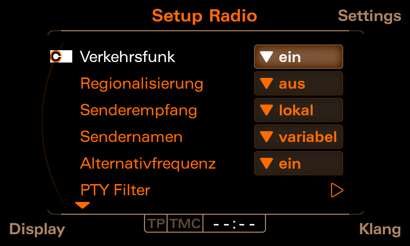

# RNS-E hardware notes: the 193 unit (variants V574, V575 and VB48)

The 2010 unit (8P0 035 193) is a different computer from the 192
described in [hardware.md](hardware.md).  Almost everything is inside
one system-on-chip of Renesas' SH7770 "SH-Navi" family, for which no
manual is public.  What follows was worked out from the firmware, with
two outside aids: the Linux kernel's SH7770 support (serial port
addresses) and the Linux driver for the display unit of the later R-Car
chips, which inherited the block almost unchanged.

Variant `V574` (software index 0220) and `VB48` (0700) use the same
memory map and the same radio processor software; their loaders differ
by a few bytes.  Which cars `VB48` is for is not known.  `V575` is the
North American software (index 0320) for the same hardware.

## Memory map

| range                 | device |
|-----------------------|--------|
| 0x00000000-0x03ffffff | NOR flash, 64 MiB, same command set as the 192's |
| 0x08000000-0x0fffffff | RAM, 128 MiB (the loader's stack starts at 0x8fffdf00) |
| 0x18000000-           | battery-backed SRAM (the OS has some 1800 references to it) |
| 0xfe008000, 0xfe800100 | not identified (a few writes at start-up; 0xfe800100 takes the key 0xa55a) |
| 0xff802000            | interrupt pin control (the layout of the SH7780's INTC: sense, mask and mask-clear registers) |
| 0xff804000            | interrupt controller |
| 0xff902000            | a second block of interrupt priority and mask registers, written alongside 0xff804000 (not emulated) |
| 0xff908000, 0xff909000 | I2C masters (not emulated) |
| 0xff915000            | serial port to the radio processor |
| 0xff926000            | serial port with FIFO to the faceplate controller |
| 0xff923000, 0xff927000 | further serial ports with FIFO (not emulated) |
| 0xff93c000            | A/D converter |
| 0xff93e000, 0xff93f000, 0xff940000 | ports; 0xff93f000 has the display motor and the supply monitor |
| 0xffc40000, 0xffc44000 | ports; 0xffc44008 bit 0 strobes the external watchdog |
| 0xffc62100            | ATAPI interface |
| 0xffd80000, 0xffd81000, 0xffd82000 | timer units, three channels each, SH7750 layout |
| 0xffdf0000            | CAN controller (RCAN-ET) |
| 0xffe40000            | serial port with FIFO, initialised by the loader but silent |
| 0xffe80000            | 2D graphics engine |
| 0xfff80000            | display unit |

Flash layout as the loader leaves it: boot ROM from 0 (not on the disc),
the module directory at 0x400000, the OS at 0x400200, the other modules
between 0xb00000 and 0x2f50000, and data from the disc's `SDS` directory
in between.  A module is stored with its 0x80-byte header, at its load
address.

## Interrupts

On-chip sources go through a controller with the layout of the SH7780's
INTC2: twelve priority registers from 0xff804000 holding four fields
each (the firmware writes them as bytes; the level is the value divided
by two), mask-set and mask-clear registers at +0x38/+0x3c and a second
pair at +0x108/+0x10c.  Everything is masked after reset.  +0x30 and
+0x100 show the requests of the two halves, +0x34 and +0x104 those that
are not masked; the radio link's handler looks at +0x100 before it
touches its port.

| source | INTEVT | priority field | mask bit | level used |
|--------|--------|----------------|----------|------------|
| display (vertical blanking) | 0x3e0 | PRI0 bits 31:24 | 0 | 14 (loader), 8 (OS) |
| timer 0 (tick) | 0x400 | PRI0 bits 23:16 | 1 | 7 |
| timer 2, underflow and capture | 0x440, 0x460 | PRI0 bits 15:8 and 7:0 | 1 | 14, 12 (OS) |
| ATAPI | 0x5e0 | PRI1 bits 7:0 | 7 | 3 |
| CAN | 0x880 | PRI5 bits 23:16 | 25 | 5 |
| graphics engine | 0x780 | PRI3 bits 7:0 | 19 | 7 |
| serial port, radio processor | 0xd20 | PRI9 bits 15:8 | 9 of the second pair | 2 |
| serial port, faceplate | 0xdc0 | PRI10 bits 23:16 | 14 of the second pair | 9 |
| A/D converter | 0xf00 | PRI11 bits 15:8 | none found | 11 |

The levels are the ones the 192 uses for the same jobs.  The timer
fields are an inference: the loader sets bits 23:16 when it starts timer
0 and the OS sets the two lower fields for timer 2, whose handlers sit
at 0x440 and 0x460.  When the OS enables the display interrupt it also
sets bit 0 of 0xff802000, so that one may be a pin rather than the
display unit's own request line; the emulator raises it from the display
unit's vertical-blanking flag either way.  The loader's
table of handlers also has entries for 0x220-0x3c0 (external interrupt
levels), 0x4c0, 0x660, 0x680, 0xaa0, 0xac0 and 0xe80, which it does not
use.

## Display unit

800 x 480 panel.  Register names below are those of the Linux R-Car
driver.

* Timing: a display period of 832 x 496 inside 1056 x 525, data enable
  800 wide.  The loader starts the period at column 181 and line 24 and
  draws its picture 16 columns and 8 lines into its surface; the OS
  starts it at 197/32 and draws from the surface's corner.  So the panel
  begins at a fixed place in the frame, 18 columns before the start of
  data enable (215) and at line 32, and that is what the emulator shows.
* Eight planes at +0x100 * n: mode at +0x00 (bits 1:0 = 8 bpp with
  palette, RGB 565 or ARGB 1555; bits 9:8 = which of four palettes;
  bits 14:12 = how the plane is laid over those behind it: bit 14 = no
  transparent colour, 1 in the low two = alpha blending), memory width
  +0x04, alpha +0x08, size +0x10/+0x14, position +0x18/+0x1c, surface
  address +0x20 (repeated at +0x24 and +0x28), start position in the
  surface +0x30/+0x34, transparent colour +0x44 (8 bpp) and +0x48 (16
  bpp), memory length +0x50.  Surfaces are ordinary RAM.
* Alpha: bits 10:8 of the alpha register say where the blending ratio
  comes from.  0: the low byte.  3: per pixel from another plane, whose
  number (from 0) is in the low bits: an 8 bpp plane that is enabled
  like the others but is not a picture.  The OS's frame and note
  overlays work this way, each with its alpha plane's surface directly
  behind its own in memory.  7 (with 0 or 1 in the low bits) is used
  for the main picture and its pop-up lists while menus are shown; what
  it selects is not known, and the emulator shows such planes without
  blending.  The A bit of ARGB 1555 pixels is not interpreted.
* Plane priority register (+0x18): eight nibbles, each naming a plane
  and enabling it with bit 3; the lowest nibble is the front.  (The OS
  puts its blended overlays in the low nibbles and the alpha planes in
  the highest.)
* Four palettes of 256 entries at +0x1000 * n, 0x00RRGGBB.
* Status at +0x08 (bit 11 = vertical blanking, bit 14 = frame), cleared
  through +0x0c, enabled as interrupts through +0x10.

The loader draws 8 bpp into a surface at 0x08110000 (the same frame
buffer offset as on the 192) shown on plane 6 with palette 2.  The OS
uses plane 6 (16 bpp, transparent colour 0x7c1f) for its main picture
and planes 1 and 3 as blended overlays (the note in the picture above
is one), with planes 8 and 7 as their alpha.

## Graphics engine

Everything the OS shows is drawn by a 2D engine at 0xffe80000 that runs
display lists from RAM; the firmware's messages call it "Q2", and the
register layout is that of the engine Renesas later named M2DG.  The
commands are not those of the 192's Coral chip.  [src/dev/q2.rs](../src/dev/q2.rs)
describes registers and commands as far as they are known: register
writes, rectangle fills, copies with a transparent colour, stretched
copies, and blending a colour through an 8-bit coverage map, which is
how text is drawn (the OS rasterises antialiased glyphs itself).  Surfaces are 16 bits per
pixel, or 8 for alpha.

The OS starts a list, waits for the interrupt its end raises (status bit
2, INTEVT 0x780) for up to four seconds and logs `Q2 TIME OUT` if it
does not come.

Two commands (0xab, 0xaa) bracket drawing into a surface that has alpha
values; what the engine does with them is partly a guess, see the source.

## ATAPI interface

Task file registers at 0xffc62100 + 4n (n = 0..7), alternate status and
device control at +0x38, one register per 32-bit word.  Data words carry
the first byte of each pair in the low half.  Interface control,
status, interrupt enable and timing registers follow from +0x80 (the
layout of the later R-Car ATAPI block); the loader sets them up once and
then works by programmed I/O.

The OS works by interrupt.  The status register (+0x84) has the drive's
interrupt line in bit 4, the end of a DMA transfer in bit 1 and an error
in bit 2; +0x88 enables each as an interrupt, and the handler switches
them off again until the driver is ready for the next.  The driver
expects the drive to interrupt when it is ready for the twelve bytes of
a packet command, which newer ATAPI drives do not do.  Disc reads go by
DMA: bit 2 of the control register (+0x80), the memory address in +0x9c
and the byte count in +0xa0 are set before the command; once the status
shows DRQ and the signal register (+0xb0) bit 0 shows the drive's DMA
request, control bit 0 starts the transfer.  Bytes land in memory in
the order the drive delivers them.

## CAN

RCAN-ET at 0xffdf0000: the control registers of the 192's HCAN2, but a
mailbox has the identifier at `STDID << 2`, the acceptance mask at +4
and the control word (type, length) at +0x10.  The loader sends the same
messages as the 192's: 0x661 and 0x604 status frames and network
management on 0x436.

### Who sets up the mailboxes

The OS programs its transmit mailboxes but no receive mailbox: it only
unmasks mailbox interrupts and then looks at the identifier of whatever
arrives, so the boot ROM must have set the receive side up.  The one
fixed point in the OS's receive path is mailbox 24, treated (as in the
loader) as the network management range 0x400-0x43f.  The emulator's
boot ROM stand-in programs that one and a single catch-all mailbox.

The OS's table of expected messages (36 slots of 40 bytes at 0x8eac58a8
in V5741040) lists 0x200, 0x271, 0x2c3, 0x351, 0x353, 0x359, 0x497,
0x523, 0x527, 0x543, 0x5c3, 0x602, 0x621, 0x623, 0x625, 0x627, 0x635,
0x63c, 0x651, 0x65d, 0x65f, 0x662, 0x665, 0x6c1, 0x6c5, 0x6d0, 0x6d1,
0x6da and 0x6dc; it transmits 0x252, 0x25b, 0x261, 0x263, 0x361, 0x461,
0x5ab, 0x604, 0x661, 0x67a, 0x6c0, 0x6c4, 0x6c6 and 0x6ca.  With the
ignition message (0x271) arriving, the power manager goes on as on the
192.

The OS does not start from nothing here either: early on it asks the
boot ROM (service 0x0b) for the state of the boot ROM's own CAN software,
including the table of received messages and whether the ignition lock's
message (0x271, or 0x2c3 on another generation of car) has been seen,
and decides from the first byte of that message (bit 0 = key in the
lock, bit 1 = ignition) whether to start up or go back to sleep.
See [boot-rom.md](boot-rom.md).

## Serial links

* 0xff915000, to the radio processor: the 192's companion-chip serial
  port with its registers four bytes apart (mode +0, baud rate +4,
  control +8, transmit +0xc, status +0x10, receive +0x14, FIFO control
  +0x18).  The protocol is the 192's (`01 command length data
  checksum`), and the OS asks the same things in the same order.
* 0xff926000, to the faceplate controller: an ordinary SCIF (control
  +0x08, transmit +0x0c, status +0x10, receive +0x14, FIFO control
  +0x18, receive count +0x20).  Same frames as on the 192; the OS sends
  commands 0x02, 0x03, 0x06, 0x07, 0x09 and 0x0a once the controller has
  announced itself with 0x0f.

## A/D converter and ports

The converter at 0xff93c000 has eight results at +0x00..+0x0e and a
control register at +0x10 (bit 15 = done, bit 14 = interrupt enable,
bit 13 = start).  The OS converts all inputs every few milliseconds and
averages them:

* input 4: position of the motorised display, as on the 192 (low =
  open; the OS logs `init_dsp_pos = 2` when it reads as closed);
* input 5: a temperature (the OS computes 25 + (1.45 V - U) / 8.2 mV);
* another input tells the type of screen fitted; the emulator leaves it
  at zero, which the OS logs as an error (`Adc_get_scrntype return
  ZERO`) and survives.

Port 0xff93f000 (direction +4, output +8, input +0xc): output bits 19
and 18 drive the display motor (assumed: 19 towards closed), input bit
20 is low only when the display is fully open, and input bit 22 has to
be high or the OS stops itself after nine seconds, waiting for the
watchdog: presumably the supply voltage monitor.

## Watchdog

External, strobed through bit 0 of the port at 0xffc44008 from the
tick.  The loader ends an update by printing `*** WDT Reset ***` and no
longer strobing; when it gets impatient it jumps to address 0 itself.
The emulator resets after 1.5 s without a strobe.

## Loader

Entry and arguments as on the 192, but the loader sets its own stack
and vector base (inside its own image).  It reads the project code from
the boot ROM header at flash 0x406, like the 192's.  Its log goes
through a `printf` (0x09e3937a in V5740002) that formats and discards;
`rnse loader` hooks it.

## Main software

The OS and the other modules have the same structure as on the 192
(three entry points each, a uITRON-style kernel, the same task names in
the debug log), with two differences in how they are started:

* The boot ROM, not the OS, calls every module's entry points: stage 1
  of each module in directory order, then stage 2, then stage 3, with
  the OS's third entry (which never returns) last.  The 192's OS does
  this for the other modules itself; the same routine is still in the
  193's OS but nothing calls it.  The order matters: the application's
  first entry moves the memory break (boot ROM service 5) from the end
  of the OS's data down to the end of its own, at 0x0ca57004, and the
  heap the OS creates later runs from the final break up to 0x0e8cfff0,
  just below the OS's data.
* The OS replaces the boot ROM's vector tables with its own, in RAM at
  0x8e8d0000 (TRAPA handlers), 0x8e8d0400 (exception and interrupt
  handlers) and 0x8e8d0600 (interrupt mask levels), and seeds them from
  the boot ROM's: 64 handlers at the old vector base (the first 16 for
  exception codes 0x000-0x1e0, all of them for TRAPA 0-63) and 125 mask
  bytes at +0x780.  See [boot-rom.md](boot-rom.md).

As on the 192, the OS starts timer 0 for its 2 ms tick without giving it
a priority; the boot ROM has done that (the loader's value is level 7,
with the timers' mask bit cleared).  The peripheral clock is 25 MHz,
going by the tick's reload value.

In the emulator the OS starts all its tasks, checks its flash file
system, sees the ignition, talks to the radio processor and the
faceplate, shows its start-up picture after about half a minute and
then its user interface, on all three variants.  It reads the disc in
the drive, takes keys from the faceplate and changes screens (radio,
set-up and so on).  A freshly installed unit first asks for the
navigation disc to load a language from ("Bitte Navigations-Medium
einlegen"), or says that the disc in the drive is not the right one; the
function keys work regardless.  `printf` is at
0x80688afe in V5741040, 0x80688146 in VB481000 and 0x8067b886 in
V57510AA.

## Not done

* The selection mark left of a list is drawn as a white box: the
  copies the engine does between its alpha commands (drawing mode bit
  0x400, another value in the rendering control register) are done as
  plain copies.
* The graphics engine's alpha commands, the A bit of ARGB pixels, and
  any drawing command the screens seen so far did not use (lines and
  polygons surely exist).
* The second interrupt register block at 0xff902000, the I2C masters,
  the remaining serial ports, DMA for the drive.
* How the OS serves the watchdog.  The emulator only watches the
  loader's strobe.
* Interrupt sources the OS registers handlers for and that have no
  model: 0x480, 0x760, 0x7a0, 0x940-0x980, 0xc00, 0xca0-0xce0, 0xde0,
  0xe20, 0xea0, 0xfa0.
