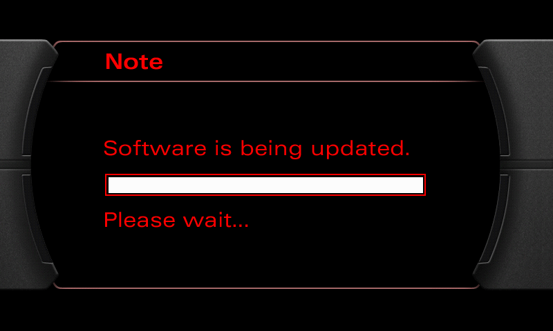

# RNS-E hardware notes: the 193 unit (variants V574 and VB48)

The 2010 unit (8P0 035 193) is a different computer from the 192
described in [hardware.md](hardware.md).  Almost everything is inside
one system-on-chip of Renesas' SH7770 "SH-Navi" family, for which no
manual is public.  What follows was worked out from the firmware, with
two outside aids: the Linux kernel's SH7770 support (serial port
addresses) and the Linux driver for the display unit of the later R-Car
chips, which inherited the block almost unchanged.

Variant `V574` (software index 0220) and `VB48` (0700) use the same
memory map and the same radio processor software; their loaders differ
by a few bytes.  Which cars `VB48` is for is not known.

## Memory map

| range                 | device |
|-----------------------|--------|
| 0x00000000-0x03ffffff | NOR flash, 64 MiB, same command set as the 192's |
| 0x08000000-0x0fffffff | RAM, 128 MiB (the loader's stack starts at 0x8fffdf00) |
| 0x18000000-           | battery-backed SRAM (the OS has some 1800 references to it) |
| 0xfe008000, 0xfe800100 | not identified (a few writes at start-up; 0xfe800100 takes the key 0xa55a) |
| 0xff802000            | bus state controller |
| 0xff804000            | interrupt controller |
| 0xff923000, 0xff926000, 0xff927000 | serial ports with FIFO (OS only; not emulated yet) |
| 0xff93c000 and other 0xff9xxxxx | further on-chip modules used by the OS only |
| 0xffc40000, 0xffc44000 | ports; 0xffc44008 bit 0 strobes the external watchdog |
| 0xffc62100            | ATAPI interface |
| 0xffd80000, 0xffd81000, 0xffd82000 | timer units, three channels each, SH7750 layout |
| 0xffdf0000            | CAN controller (RCAN-ET) |
| 0xffe40000            | serial port with FIFO, initialised by the loader but silent |
| 0xfff80000            | display unit |

Flash layout as the loader leaves it: boot ROM from 0 (not on the disc),
the module directory at 0x400000, the OS at 0x400200, the other modules
between 0xb00000 and 0x2f50000, and data from the disc's `SDS` directory
in between.  A module is stored with its 0x80-byte header, at its load
address.

## Interrupts

On-chip sources go through a controller with the layout of the SH7780's
INTC2: twelve priority registers from 0xff804000 holding four fields
each (the firmware writes them as bytes; the level is the value divided
by two), mask-set and mask-clear registers at +0x38/+0x3c and a second
pair at +0x108/+0x10c.  Everything is masked after reset.

| source | INTEVT | priority field | mask bit | level used |
|--------|--------|----------------|----------|------------|
| display unit | 0x3e0 | PRI0 bits 31:24 | 0 | 14 |
| timer 0 (tick) | 0x400 | PRI0 bits 23:16 | 1 | 7 |
| ATAPI | 0x5e0 | PRI1 bits 7:0 | 7 | 3 |
| CAN | 0x880 | PRI5 bits 23:16 | 25 | 5 |

The levels are the ones the 192 uses for the same jobs.  The loader's
table of handlers also has entries for 0x220-0x3c0 (external interrupt
levels), 0x4c0, 0x660, 0x680, 0xaa0, 0xac0 and 0xe80, which it does not
use.

## Display unit

800 x 480 panel.  Register names below are those of the Linux R-Car
driver.

* Timing as programmed by the loader: display period 832 x 496 inside
  1056 x 525, data enable 800 wide starting 34 pixels into the period.
  The emulator shows the 800 data-enable columns and, as an assumption,
  the middle 480 lines.
* Eight planes at +0x100 * n: mode (bits 1:0 = 8 bpp with palette, RGB
  565 or ARGB 1555; bits 9:8 = which of four palettes; bit 14 = no
  transparent colour), memory width, size, position, surface address,
  start position in the surface, transparent colour.  Surfaces are
  ordinary RAM.
* Plane priority register (+0x18): eight nibbles, each naming a plane
  and enabling it with bit 3.  The emulator draws the highest nibble
  first; with a single plane, as in the loader, this is untested.
* Four palettes of 256 entries at +0x1000 * n, 0x00RRGGBB.
* Status at +0x08 (bit 11 = vertical blanking, bit 14 = frame), cleared
  through +0x0c, enabled as interrupts through +0x10.

The loader draws 8 bpp into a surface at 0x08110000 (the same frame
buffer offset as on the 192) shown on plane 6 with palette 2.

## ATAPI interface

Task file registers at 0xffc62100 + 4n (n = 0..7), alternate status and
device control at +0x38, one register per 32-bit word.  Data words carry
the first byte of each pair in the low half.  Interface control,
status, interrupt enable and timing registers follow from +0x80 (the
layout of the later R-Car ATAPI block); the loader sets them up once and
then works by programmed I/O.  The OS also uses the block's DMA
registers, which are not emulated yet.

## CAN

RCAN-ET at 0xffdf0000: the control registers of the 192's HCAN2, but a
mailbox has the identifier at `STDID << 2`, the acceptance mask at +4
and the control word (type, length) at +0x10.  The loader sends the same
messages as the 192's: 0x661 and 0x604 status frames and network
management on 0x436.

## Watchdog

External, strobed through bit 0 of the port at 0xffc44008 from the
tick.  The loader ends an update by printing `*** WDT Reset ***` and no
longer strobing; when it gets impatient it jumps to address 0 itself.
The emulator resets after 1.5 s without a strobe.

## Loader

Entry and arguments as on the 192, but the loader sets its own stack
and vector base (inside its own image).  It reads the project code from
the boot ROM header at flash 0x406, like the 192's.  Its log goes
through a `printf` (0x09e3937a in V5740002) that formats and discards;
`rnse loader` hooks it.

## Not done

The main software (OS and applications) has not been started on this
model yet.  It will need at least the boot ROM services, the serial
ports, the remaining interrupt sources and whatever it uses to draw
(the display unit alone only shows surfaces).
